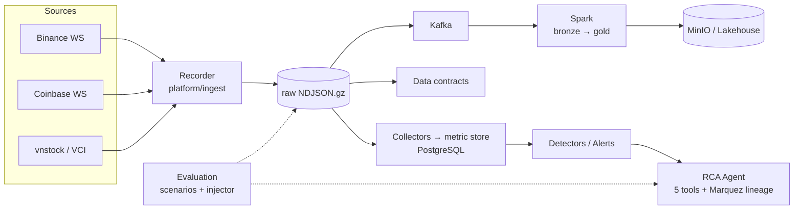

# FinObs

**FinObs** là nền tảng *data observability* cho dữ liệu tài chính thời gian thực. Hệ thống thu tick giao dịch từ
nhiều nguồn (Binance, Coinbase, VN30 qua vnstock), kiểm tra dữ liệu theo data contract, tính các metric chất lượng
(độ tươi, khối lượng, phân phối...) và dùng một agent LLM để chẩn đoán nguyên nhân gốc khi dữ liệu hỏng âm thầm
(*silent data failures*): trùng lặp, đổi schema, lệch đồng hồ, dữ liệu cũ...

> Trạng thái: đang phát triển, hiện ở **Sprint 2**. Xem [Trạng thái dự án](#trạng-thái-dự-án).

---

## Mục lục

- [Kiến trúc](#kiến-trúc)
- [Trạng thái dự án](#trạng-thái-dự-án)
- [Cấu trúc thư mục](#cấu-trúc-thư-mục)
- [Cài đặt](#cài-đặt)
- [Sử dụng](#sử-dụng)
- [Quy ước dữ liệu](#quy-ước-dữ-liệu)
- [Kiểm thử và CI](#kiểm-thử-và-ci)
- [Quy trình đóng góp](#quy-trình-đóng-góp)
- [Tài liệu](#tài-liệu)

---

## Kiến trúc



Các khối có trong repo nhưng chưa được hiện thực: Kafka → Spark → Lakehouse, detector, vòng lặp agent, injector và
benchmark (xem bảng dưới).

## Trạng thái dự án

| Mảng | Đã có | Chưa có |
|---|---|---|
| **Hạ tầng** | Docker Compose: Kafka 3.9 (KRaft), MinIO, Spark master/worker; Makefile; CI | Helm, cấu hình triển khai |
| **Ingest** | Recorder Binance/Coinbase (WebSocket), vnstock (poll VCI), `clock_check`, `analyze` | Producer đẩy vào Kafka |
| **Data contract** | 3 JSON Schema (envelope, Binance, Coinbase), `validate.py`, 22 fixture lỗi | Schema vnstock |
| **Xử lý dữ liệu** | — | Streaming, batch, dbt, DAG |
| **Observability** | Metric catalog, collector `trade_count_1m`, schema PostgreSQL cho metric store | Detector, SLO, reconcile, cross-source, incident |
| **Agent** | 5 tool + JSON schema, client Marquez, dữ liệu giả theo kịch bản S002, 21 test | Prompt, vòng lặp gọi LLM, dữ liệu thật |
| **Evaluation** | Fault taxonomy FT01–FT12, scenario schema, 4 kịch bản, validator, unit test | Injector, bench, kết quả |
| **API / Dashboard** | — | Chưa bắt đầu |

**Kết quả Sprint 1** (thu thật 60 phút, 2026-10-27 02:48–03:48 UTC): 231 859 trade từ 20 mã, 0 reconnect, 100%
bản ghi đạt contract. Độ trễ p50/p99: Binance 7/42 ms, Coinbase 160/272 ms. Chi tiết trong
[docs/sprint1/summary.md](docs/sprint1/summary.md) và [reports/throughput.md](reports/throughput.md).

**Việc đang chờ:** chính sách tương thích của scenario schema (quyết định D01–D05) trong
[evaluation/SPRINT2_REVIEW_HANDOFF.md](evaluation/SPRINT2_REVIEW_HANDOFF.md).

## Cấu trúc thư mục

```text
finobs/
├── agent/tools/          # 5 tool cho agent chẩn đoán, schema JSON, client Marquez, dữ liệu giả
├── config/symbols.json   # Danh sách mã theo từng nguồn
├── docs/                 # Báo cáo sprint, slide, ghi chú paper, bản nháp báo cáo LaTeX
├── evaluation/           # Fault taxonomy, scenario YAML, validator, handoff Sprint 2
├── infra/                # docker-compose.yml (Helm, configs: dự kiến)
├── observability/        # Metric catalog, collector, SQL cho metric store
├── platform/
│   ├── contracts/        # JSON Schema cho raw event + validate.py
│   └── ingest/           # Recorder, clock_check, analyze
├── reports/              # Bảng đo và biểu đồ do `make analyze` sinh ra
├── tests/                # Unit test và fixture (hợp lệ / cố ý sai)
├── Makefile
└── requirements-*.txt    # ingest, observability, eval
```

Các thư mục chỉ chứa `.gitkeep` (`api/`, `dashboards/`, `platform/streaming/`...) là chỗ dành sẵn cho các sprint sau.

## Cài đặt

### Yêu cầu

- Git, GNU Make
- Docker Engine hoặc Docker Desktop, kèm Docker Compose
- Python 3.11 trở lên

Trên Windows nên dùng **WSL2 Ubuntu** và bật Docker Desktop WSL integration.

```bash
git --version && docker --version && docker compose version && make --version && python3 --version
docker info   # Docker daemon phải đang chạy
```

### Các bước

```bash
git clone https://github.com/tattu1812/finobs.git
cd finobs

cp .env.example .env      # rồi sửa MINIO_ROOT_PASSWORD và các cổng nếu cần
make venv                 # tạo .venv và cài requirements-ingest.txt
```

Biến môi trường trong `.env`:

| Biến | Mặc định | Ý nghĩa |
|---|---|---|
| `KAFKA_PORT` | `9092` | Cổng Kafka cho client trên máy host |
| `MINIO_API_PORT` / `MINIO_CONSOLE_PORT` | `9000` / `9001` | API và giao diện MinIO |
| `MINIO_ROOT_USER` / `MINIO_ROOT_PASSWORD` | `finobs` / `change_me_before_use` | Tài khoản MinIO. **Đổi mật khẩu trước khi dùng** |
| `SPARK_UI_PORT` | `8080` | Spark Master UI |

Không commit `.env` hay mật khẩu thật lên GitHub (`.env` đã có trong `.gitignore`).

## Sử dụng

### Hạ tầng

```bash
make check     # kiểm tra cấu hình Docker Compose
make up        # khởi chạy Kafka, MinIO, Spark master, Spark worker
make ps        # xem trạng thái container
```

- MinIO Console: <http://localhost:9001>
- Spark Master UI: <http://localhost:8080>

`make down` xóa container nhưng giữ volume. Không dùng `docker compose down -v` nếu cần giữ dữ liệu.

### Thu và phân tích dữ liệu

```bash
make record MINUTES=60              # chạy clock-check trước, rồi thu Binance + Coinbase
make record SOURCES=vnstock         # chỉ chạy được trong giờ giao dịch HOSE
make analyze                        # sinh bảng đo và biểu đồ vào reports/
```

Dữ liệu được ghi vào `data/raw/<source>/<YYYY-MM-DD>/<HH>.jsonl.gz`. Thư mục `data/` không được commit.
Trước khi thu phải đồng bộ giờ hệ thống: `clock_check` sẽ chặn nếu đồng hồ lệch quá 250 ms.

### Kiểm tra contract và scenario

```bash
make validate-contracts             # validate data/raw (nếu chưa có thì dùng fixtures) + các ca lỗi cố ý
make validate-scenarios             # validate evaluation/scenarios/*.yaml + các ca lỗi cố ý
```

### Observability

```bash
python observability/collectors/trade_count.py --in tests/fixtures/raw    # xem trước, không cần DB
```

Muốn ghi vào PostgreSQL: chạy các file SQL trong `observability/store/`, cài `requirements-observability.txt`,
đặt `FINOBS_METRIC_DSN`, rồi thêm cờ `--write-db`. Xem [observability/collectors/README.md](observability/collectors/README.md).

### Agent

```bash
make test-agent                                         # test 5 tool trên dữ liệu giả
make lineage                                            # in đồ thị lineage kèm alert
make lineage MARQUEZ_URL=http://localhost:5000          # dùng Marquez thật
```

Xem [agent/tools/README.md](agent/tools/README.md).

### Tất cả lệnh Make

| Lệnh | Công dụng |
|---|---|
| `make help` | Liệt kê các lệnh |
| `make check` / `up` / `ps` / `logs` / `stop` / `restart` / `down` | Quản lý Docker Compose |
| `make venv` | Tạo `.venv` và cài dependency cho ingest |
| `make clock-check` | Đo độ lệch đồng hồ, ghi vào `reports/clock_check.jsonl` |
| `make record` | Thu dữ liệu (`MINUTES`, `SOURCES`, `RAW`) |
| `make analyze` | Sinh bảng đo và biểu đồ |
| `make validate-contracts` | Validate data contract |
| `make validate-scenarios` | Validate scenario evaluation |
| `make test-agent` | Test các tool của agent |
| `make lineage` | In đồ thị lineage |

> **Lưu ý:** script trong `platform/` phải chạy bằng đường dẫn file (`python platform/ingest/record.py`), không dùng
> `python -m platform...`, vì tên `platform` trùng với một module chuẩn của Python. Riêng package `agent` thì chạy
> bằng `python -m agent...` từ gốc repo.

## Quy ước dữ liệu

Mọi thành phần đọc dữ liệu raw đều phải tuân theo các quy ước sau:

- **Khử trùng theo `event_id`.** Bỏ các bản ghi có `transport.is_snapshot = true` khi tính chỉ số realtime.
- **Giá và khối lượng là string.** Parse bằng `Decimal` / `DECIMAL(38,18)`, không dùng `float`.
- **Thời gian** dùng UTC, ISO 8601, độ chính xác mili giây, hậu tố `Z`.
- **Mã chuẩn hóa** có dạng `BASE-QUOTE`. `BTC-USDT` (Binance) và `BTC-USD` (Coinbase) là hai cặp khác nhau.
- **Watermark riêng cho từng nguồn:** Binance 0–200 ms, Coinbase 500 ms, vnstock khoảng 10 s.
- **Sửa schema** thì phải tăng `SCHEMA_VERSION` trong cùng PR, theo SemVer
  (xem [platform/contracts/README.md](platform/contracts/README.md)).

## Kiểm thử và CI

GitHub Actions ([.github/workflows/ci.yml](.github/workflows/ci.yml)) chạy trên mỗi push và PR vào `main`:

1. `ruff check .`
2. `make validate-contracts` trên fixtures
3. `make validate-scenarios`
4. `make test-agent`
5. Kiểm tra cấu hình Docker Compose

Chạy lại ở máy local trước khi mở PR:

```bash
.venv/bin/pip install ruff==0.9.10
.venv/bin/ruff check .
make validate-contracts validate-scenarios test-agent
.venv/bin/python -m unittest tests.test_trade_count_collector -v
```

## Quy trình đóng góp

- Nhánh `main` được bảo vệ: PR cần **ít nhất 1 approve** và **CI xanh** mới được merge.
- Tạo nhánh riêng cho mỗi việc, không push thẳng lên `main`.
- Commit message nên theo dạng `type(scope): mô tả`, ví dụ `feat(ingest): ...`, `docs(s1): ...`.
- Không commit `.env`, `data/`, `.venv/` hay file `__pycache__`.

## 8. Iceberg + Trino(S2)
Bổ sung Apache Iceberg REST Catalog và Trino vào hạ tầng FinObs. Cấu hình nằm trên nhánh tattu/3-iceberg-trino

### 8.1. Các thành phần: MinIO, Iceberg REST Catalog, SQLite, Trino, iceberg-init
### 8.2. Chuẩn bị MinIO
1. Truy cập MinIO Console tại http://localhost:9001.

2. Đăng nhập bằng thông tin trong file .env.

3. Mở mục Buckets.

4. Tạo bucket có tên finobs-warehouse.
### 8.3. Khởi động
Chạy lần lượt các lệnh:

make check -> make up -> make ps

Các dịch vụ bổ sung gồm:


Iceberg REST Catalog -> http://localhost:8181

Trino HTTP endpoint -> http://localhost:8081

MinIO Console -> http://localhost:9001

iceberg-init kết thúc với trạng thái Exited (0) là bình thường, vì container này chỉ thực hiện bước khởi tạo quyền cho volume.
### 8.4. Kiểm tra kết nối Iceberg
```bash
docker exec finobs-trino trino --execute "SHOW CATALOGS"
```
Kết quả cần có catalog iceberg.

### 8.5. Tạo schema và bảng mẫu
```bash
docker exec finobs-trino trino --execute \
"CREATE SCHEMA iceberg.finobs_test
WITH (location = 's3://finobs-warehouse/finobs_test/')"

docker exec finobs-trino trino --execute \
"CREATE TABLE iceberg.finobs_test.transactions (
    transaction_id BIGINT,
    amount DOUBLE,
    status VARCHAR
)"
```
Các lệnh tạo schema và bảng chỉ cần chạy một lần. Nếu đối tượng đã tồn tại, bỏ qua bước tạo tương ứng.

### 8.6. Ghi và truy vấn dữ liệu
```bash
docker exec finobs-trino trino --execute \
"INSERT INTO iceberg.finobs_test.transactions
VALUES
    (1, 150.50, 'SUCCESS'),
    (2, 299.99, 'SUCCESS'),
    (3, 75.00, 'FAILED')"

docker exec finobs-trino trino --execute \
"SELECT transaction_id, amount, status
FROM iceberg.finobs_test.transactions
ORDER BY transaction_id"
```
Kết quả mẫu:

"1","150.5","SUCCESS"
"2","299.99","SUCCESS"
"3","75.0","FAILED"

Lưu ý: Chạy lại lệnh INSERT sẽ thêm các bản ghi trùng ID vì bảng mẫu chưa khai báo ràng buộc duy nhất.

### 8.7. Kiểm tra dữ liệu sau khi tạo lại Iceberg REST Catalog
```bash
docker compose --env-file .env -f infra/docker-compose.yml \
  up -d --force-recreate iceberg-rest
```
Sau đó chạy lại câu lệnh SELECT ở mục 8.6. Dữ liệu đã ghi cần tiếp tục truy vấn được.

SQLite Catalog được lưu trong Docker named volume iceberg_catalog_data, còn dữ liệu bảng được lưu trong MinIO. Không chạy docker compose down -v nếu muốn giữ dữ liệu.

### 8.8. Lưu ý triển khai

Đây là cấu hình phục vụ môi trường phát triển và demo, chưa phải cấu hình production.

Bucket finobs-warehouse hiện cần tạo thủ công.

Không commit .env hoặc mật khẩu thật.

Trino sử dụng cổng 8081 trên máy host để tránh xung đột với Spark Master UI ở cổng 8080.

Cảnh báo Unable to create a system terminal, creating a dumb terminal từ Trino CLI không ảnh hưởng đến kết quả truy vấn.
## Tài liệu

| Tài liệu | Nội dung |
|---|---|
| [docs/sprint1/summary.md](docs/sprint1/summary.md) | Tóm tắt Sprint 1 trong một trang |
| [docs/sprint1/report.md](docs/sprint1/report.md) | Báo cáo đầy đủ Sprint 1 |
| [docs/papers/](docs/papers/) | Ghi chú paper Dataflow Model và Lakehouse |
| [platform/contracts/README.md](platform/contracts/README.md) | Data contract tầng raw |
| [observability/metric_catalog.yaml](observability/metric_catalog.yaml) | Định nghĩa metric |
| [agent/tools/README.md](agent/tools/README.md) | Tool của agent chẩn đoán |
| [evaluation/fault_taxonomy.md](evaluation/fault_taxonomy.md) | Phân loại lỗi FT01–FT12 |
| [evaluation/scenarios/README.md](evaluation/scenarios/README.md) | Hướng dẫn viết scenario |
| [evaluation/SPRINT2_REVIEW_HANDOFF.md](evaluation/SPRINT2_REVIEW_HANDOFF.md) | Bàn giao và các quyết định đang chờ của Sprint 2 |
