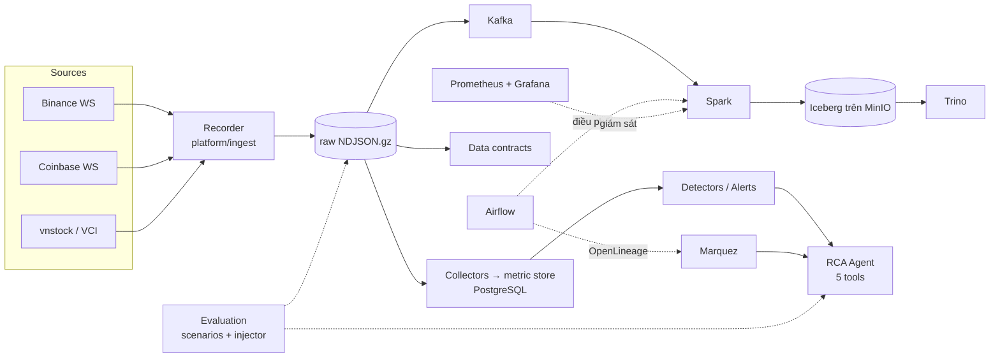

# FinObs

**FinObs** là nền tảng *data observability* cho dữ liệu tài chính thời gian thực. Hệ thống thu tick giao dịch từ
nhiều nguồn (Binance, Coinbase, VN30 qua vnstock), kiểm tra dữ liệu theo data contract, tính các metric chất lượng
(độ tươi, khối lượng, phân phối...) và dùng một agent LLM để chẩn đoán nguyên nhân gốc khi dữ liệu hỏng âm thầm
(*silent data failures*): trùng lặp, đổi schema, lệch đồng hồ, dữ liệu cũ...

> Trạng thái: đang phát triển, hiện ở **Sprint 2**. Xem [Trạng thái dự án](#trạng-thái-dự-án).

---

## Mục lục

- [Kiến trúc](#kiến-trúc)
- [Trạng thái dự án](#trạng-thái-dự-án)
- [Cấu trúc thư mục](#cấu-trúc-thư-mục)
- [Cài đặt](#cài-đặt)
- [Khởi chạy hạ tầng](#khởi-chạy-hạ-tầng)
- [Sử dụng](#sử-dụng)
- [Quy ước dữ liệu](#quy-ước-dữ-liệu)
- [Kiểm thử và CI](#kiểm-thử-và-ci)
- [Quy trình đóng góp](#quy-trình-đóng-góp)
- [Tài liệu](#tài-liệu)

---

## Kiến trúc



Hạ tầng của mọi khối trên đã chạy được bằng Docker Compose. Phần còn thiếu là **luồng dữ liệu nối các khối**
(recorder → Kafka → Spark → Iceberg), các job Airflow, detector, vòng lặp agent và benchmark (xem bảng dưới).

## Trạng thái dự án

| Mảng | Đã có | Chưa có |
|---|---|---|
| **Hạ tầng** | Docker Compose: Kafka, MinIO, Spark, Iceberg REST + Trino, Airflow, Marquez, Prometheus + Grafana; Helm chart phác thảo (mới có template Trino); CI | Template Helm cho các thành phần còn lại, cấu hình production |
| **Ingest** | Recorder Binance/Coinbase (WebSocket), vnstock (poll VCI), `clock_check`, `analyze` | Producer đẩy vào Kafka |
| **Data contract** | 3 JSON Schema (envelope, Binance, Coinbase), `validate.py`, 22 fixture lỗi | Schema vnstock |
| **Xử lý dữ liệu** | Bảng Iceberg mẫu để thử kết nối | Job Spark (bronze → gold), DAG Airflow, dbt |
| **Lineage** | Marquez nhận sự kiện OpenLineage (thử bằng API) | Airflow/Spark tự phát lineage |
| **Giám sát hạ tầng** | Dashboard Grafana, alert `SparkMasterDown` / `SparkWorkerDown` | Gửi thông báo (Alertmanager) |
| **Observability dữ liệu** | Metric catalog, collector `trade_count_1m`, schema PostgreSQL cho metric store | Detector, SLO, reconcile, cross-source, incident |
| **Agent** | 5 tool + JSON schema, client Marquez, dữ liệu giả theo kịch bản S002, 21 test | Prompt, vòng lặp gọi LLM, dữ liệu thật |
| **Evaluation** | Fault taxonomy FT01–FT12, scenario schema, 4 kịch bản, validator, unit test | Injector, bench, kết quả |
| **API / Dashboard nghiệp vụ** | — | Chưa bắt đầu |

**Kết quả Sprint 1** (thu thật 60 phút, 2026-10-27 02:48–03:48 UTC): 231 859 trade từ 20 mã, 0 reconnect, 100%
bản ghi đạt contract. Độ trễ p50/p99: Binance 7/42 ms, Coinbase 160/272 ms. Chi tiết trong
[docs/sprint1/summary.md](docs/sprint1/summary.md) và [reports/throughput.md](reports/throughput.md).

**Việc đang chờ:** chính sách tương thích của scenario schema (quyết định D01–D05) trong
[evaluation/SPRINT2_REVIEW_HANDOFF.md](evaluation/SPRINT2_REVIEW_HANDOFF.md).

## Cấu trúc thư mục

```text
finobs/
├── agent/tools/          # 5 tool cho agent chẩn đoán, schema JSON, client Marquez, dữ liệu giả
├── config/symbols.json   # Danh sách mã theo từng nguồn
├── docs/                 # Báo cáo sprint, hướng dẫn hạ tầng, ghi chú paper, bản nháp báo cáo LaTeX
├── evaluation/           # Fault taxonomy, scenario YAML, validator, handoff Sprint 2
├── infra/
│   ├── docker-compose.yml
│   ├── airflow/dags/     # DAG Airflow (mount vào container)
│   ├── configs/          # Cấu hình Marquez, Prometheus, Grafana, Spark metrics, Trino catalog
│   └── helm/finobs/      # Helm chart phác thảo
├── observability/        # Metric catalog, collector, SQL cho metric store
├── platform/
│   ├── contracts/        # JSON Schema cho raw event + validate.py
│   └── ingest/           # Recorder, clock_check, analyze
├── reports/              # Bảng đo và biểu đồ do `make analyze` sinh ra
├── tests/                # Unit test và fixture (hợp lệ / cố ý sai)
├── Makefile
└── requirements-*.txt    # ingest, observability, eval
```

Các thư mục chỉ chứa `.gitkeep` (`api/`, `dashboards/`, `platform/streaming/`...) là chỗ dành sẵn cho các sprint sau.

## Cài đặt

### Yêu cầu

- Git, GNU Make
- Docker Engine hoặc Docker Desktop, kèm Docker Compose. Chạy toàn bộ stack (15 container) nên cấp cho Docker ít nhất 8 GB RAM.
- Python 3.11 trở lên
- Helm 3 (chỉ khi làm việc với Helm chart)

Trên Windows nên dùng **WSL2 Ubuntu** và bật Docker Desktop WSL integration.

```bash
git --version && docker --version && docker compose version && make --version && python3 --version
docker info   # Docker daemon phải đang chạy
```

### Các bước

```bash
git clone https://github.com/tattu1812/finobs.git
cd finobs

cp .env.example .env      # rồi đổi toàn bộ mật khẩu
make venv                 # tạo .venv và cài requirements-ingest.txt
```

### Biến môi trường (`.env`)

| Biến | Mặc định | Ý nghĩa |
|---|---|---|
| `COMPOSE_PROJECT_NAME` | `finobs` | Tên project Docker Compose |
| `KAFKA_PORT` | `9092` | Cổng Kafka cho client trên máy host |
| `MINIO_API_PORT` / `MINIO_CONSOLE_PORT` | `9000` / `9001` | API và giao diện MinIO |
| `MINIO_ROOT_USER` / `MINIO_ROOT_PASSWORD` | `finobs` / `change_me_before_use` | Tài khoản MinIO, dùng chung cho Iceberg và Trino |
| `SPARK_UI_PORT` | `8082` | Spark Master UI |
| `AIRFLOW_PORT` | `8080` | Airflow Web UI |
| `AIRFLOW_DB_PASSWORD` | `change_me_before_use` | Mật khẩu PostgreSQL của Airflow |
| `MARQUEZ_DB_PASSWORD` | `change_me` | Mật khẩu PostgreSQL của Marquez |
| `GRAFANA_ADMIN_PASSWORD` | `change-me-for-local-development` | Mật khẩu `admin` của Grafana. **Bắt buộc**, thiếu thì `make check` báo lỗi |

Không commit `.env` hay mật khẩu thật lên GitHub (`.env` đã có trong `.gitignore`). Khi `.env.example` có biến mới,
nhớ chép biến đó sang `.env` của bạn.

## Khởi chạy hạ tầng

```bash
make check     # kiểm tra cấu hình Docker Compose
make up        # khởi chạy toàn bộ dịch vụ
make ps        # xem trạng thái container
```

### Dịch vụ và cổng

| Dịch vụ | Địa chỉ trên máy host | Ghi chú |
|---|---|---|
| Kafka | `localhost:9092` | Trong mạng Docker: `kafka:29092` |
| MinIO API / Console | <http://localhost:9000> / <http://localhost:9001> | Đăng nhập bằng `MINIO_ROOT_USER` / `MINIO_ROOT_PASSWORD` |
| Spark Master | `spark://localhost:7077`, UI <http://localhost:8082> | |
| Iceberg REST Catalog | <http://localhost:8181> | Catalog lưu trong SQLite (volume `iceberg_catalog_data`) |
| Trino | <http://localhost:8081> | Catalog `iceberg` |
| Airflow | <http://localhost:8080> | Cần tạo tài khoản admin lần đầu (xem dưới) |
| Marquez API | <http://localhost:5000> | Chưa có Web UI |
| Prometheus | <http://localhost:9090> | |
| Grafana | <http://localhost:3000> | Tài khoản `admin` / `GRAFANA_ADMIN_PASSWORD` |

Hai container `finobs-iceberg-init` và `finobs-airflow-init` dừng với trạng thái `Exited (0)` là bình thường: chúng
chỉ chạy một lần để chuẩn bị volume và migrate database Airflow.

### Chuẩn bị lần đầu

1. **Tạo bucket `finobs-warehouse` trong MinIO** (bắt buộc cho Iceberg): vào MinIO Console → *Buckets* → *Create Bucket*.
2. **Tạo tài khoản admin Airflow:**

   ```bash
   docker compose --env-file .env -f infra/docker-compose.yml run --rm --entrypoint airflow airflow-init \
     users create --username admin --firstname FinObs --lastname Admin --role Admin --email admin@finobs.local
   ```

### Kiểm tra nhanh

```bash
docker exec finobs-trino trino --execute "SHOW CATALOGS"      # phải có catalog iceberg
curl -i http://localhost:5000/api/v1/namespaces               # Marquez trả 200 OK
```

Prometheus targets: <http://localhost:9090/targets>. Grafana: thư mục *FinObs* → dashboard
*FinObs - Infrastructure Monitoring*.

### Thử Iceberg qua Trino

```bash
docker exec finobs-trino trino --execute \
  "CREATE SCHEMA IF NOT EXISTS iceberg.finobs_test WITH (location = 's3://finobs-warehouse/finobs_test/')"

docker exec finobs-trino trino --execute \
  "CREATE TABLE IF NOT EXISTS iceberg.finobs_test.transactions (transaction_id BIGINT, amount DOUBLE, status VARCHAR)"

docker exec finobs-trino trino --execute \
  "INSERT INTO iceberg.finobs_test.transactions VALUES (1, 150.50, 'SUCCESS'), (2, 299.99, 'SUCCESS'), (3, 75.00, 'FAILED')"

docker exec finobs-trino trino --execute \
  "SELECT * FROM iceberg.finobs_test.transactions ORDER BY transaction_id"
```

Chạy lại `INSERT` sẽ thêm bản ghi trùng ID vì bảng mẫu không có ràng buộc duy nhất. Cảnh báo
`Unable to create a system terminal` của Trino CLI không ảnh hưởng kết quả.

### Dừng và dữ liệu

`make stop` dừng container; `make down` xóa container nhưng **giữ volume** (dữ liệu Kafka, MinIO, catalog Iceberg,
PostgreSQL, Prometheus, Grafana). Không dùng `docker compose down -v` nếu cần giữ dữ liệu.

Cấu hình hiện tại chỉ dành cho môi trường phát triển và demo, chưa phải production.

## Sử dụng

### Thu và phân tích dữ liệu

```bash
make record MINUTES=60              # chạy clock-check trước, rồi thu Binance + Coinbase
make record SOURCES=vnstock         # chỉ chạy được trong giờ giao dịch HOSE
make analyze                        # sinh bảng đo và biểu đồ vào reports/
```

Dữ liệu được ghi vào `data/raw/<source>/<YYYY-MM-DD>/<HH>.jsonl.gz`. Thư mục `data/` không được commit.
Trước khi thu phải đồng bộ giờ hệ thống: `clock_check` sẽ chặn nếu đồng hồ lệch quá 250 ms.

### Kiểm tra contract và scenario

```bash
make validate-contracts             # validate data/raw (nếu chưa có thì dùng fixtures) + các ca lỗi cố ý
make validate-scenarios             # validate evaluation/scenarios/*.yaml + các ca lỗi cố ý
```

### Observability

```bash
python observability/collectors/trade_count.py --in tests/fixtures/raw    # xem trước, không cần DB
```

Muốn ghi vào PostgreSQL: chạy các file SQL trong `observability/store/`, cài `requirements-observability.txt`,
đặt `FINOBS_METRIC_DSN`, rồi thêm cờ `--write-db`. Xem [observability/collectors/README.md](observability/collectors/README.md).

### Agent

```bash
make test-agent                                         # test 5 tool trên dữ liệu giả
make lineage                                            # in đồ thị lineage kèm alert
make lineage MARQUEZ_URL=http://localhost:5000          # dùng Marquez thật
```

Xem [agent/tools/README.md](agent/tools/README.md).

### Tất cả lệnh Make

| Lệnh | Công dụng |
|---|---|
| `make help` | Liệt kê các lệnh |
| `make check` / `up` / `ps` / `logs` / `stop` / `restart` / `down` | Quản lý Docker Compose |
| `make venv` | Tạo `.venv` và cài dependency cho ingest |
| `make clock-check` | Đo độ lệch đồng hồ, ghi vào `reports/clock_check.jsonl` |
| `make record` | Thu dữ liệu (`MINUTES`, `SOURCES`, `RAW`) |
| `make analyze` | Sinh bảng đo và biểu đồ |
| `make validate-contracts` | Validate data contract |
| `make validate-scenarios` | Validate scenario evaluation |
| `make test-agent` | Test các tool của agent |
| `make test-observability` | Test collector `trade_count_1m` |
| `make lineage` | In đồ thị lineage |

> **Lưu ý:** script trong `platform/` phải chạy bằng đường dẫn file (`python platform/ingest/record.py`), không dùng
> `python -m platform...`, vì tên `platform` trùng với một module chuẩn của Python. Riêng package `agent` thì chạy
> bằng `python -m agent...` từ gốc repo.

## Quy ước dữ liệu

Mọi thành phần đọc dữ liệu raw đều phải tuân theo các quy ước sau:

- **Khử trùng theo `event_id`.** Bỏ các bản ghi có `transport.is_snapshot = true` khi tính chỉ số realtime.
- **Giá và khối lượng là string.** Parse bằng `Decimal` / `DECIMAL(38,18)`, không dùng `float`.
- **Thời gian** dùng UTC, ISO 8601, độ chính xác mili giây, hậu tố `Z`.
- **Mã chuẩn hóa** có dạng `BASE-QUOTE`. `BTC-USDT` (Binance) và `BTC-USD` (Coinbase) là hai cặp khác nhau.
- **Watermark riêng cho từng nguồn:** Binance 0–200 ms, Coinbase 500 ms, vnstock khoảng 10 s.
- **Sửa schema** thì phải tăng `SCHEMA_VERSION` trong cùng PR, theo SemVer
  (xem [platform/contracts/README.md](platform/contracts/README.md)).

## Kiểm thử và CI

GitHub Actions ([.github/workflows/ci.yml](.github/workflows/ci.yml)) chạy trên mỗi push và PR vào `main`:

1. `ruff check .`
2. `make validate-contracts` trên fixtures
3. `make validate-scenarios`
4. `make test-agent` và `make test-observability`
5. Kiểm tra cấu hình Docker Compose
6. `helm lint` và `helm template` cho `infra/helm/finobs`

Chạy lại ở máy local trước khi mở PR:

```bash
.venv/bin/pip install ruff==0.9.10
.venv/bin/ruff check .
make validate-contracts validate-scenarios test-agent test-observability
make check
helm lint infra/helm/finobs        # nếu có sửa Helm chart
```

## Quy trình đóng góp

- Nhánh `main` được bảo vệ: PR cần **ít nhất 1 approve** và **CI xanh** mới được merge.
- Tạo nhánh riêng cho mỗi việc, không push thẳng lên `main`.
- Commit message nên theo dạng `type(scope): mô tả`, ví dụ `feat(ingest): ...`, `docs(s1): ...`.
- Không commit `.env`, `data/`, `.venv/` hay file `__pycache__`.
- Thêm biến môi trường mới thì cập nhật cả `.env.example` và bảng biến môi trường trong README.

## Tài liệu

| Tài liệu | Nội dung |
|---|---|
| [docs/sprint1/summary.md](docs/sprint1/summary.md) | Tóm tắt Sprint 1 trong một trang |
| [docs/sprint1/report.md](docs/sprint1/report.md) | Báo cáo đầy đủ Sprint 1 |
| [docs/airflow-marquez.md](docs/airflow-marquez.md) | Triển khai và kiểm thử Airflow, Marquez, OpenLineage |
| [docs/monitoring.md](docs/monitoring.md) | Prometheus, Grafana, alert rules |
| [infra/helm/finobs/README.md](infra/helm/finobs/README.md) | Helm chart phác thảo |
| [docs/papers/](docs/papers/) | Ghi chú paper Dataflow Model và Lakehouse |
| [platform/contracts/README.md](platform/contracts/README.md) | Data contract tầng raw |
| [observability/metric_catalog.yaml](observability/metric_catalog.yaml) | Định nghĩa metric |
| [agent/tools/README.md](agent/tools/README.md) | Tool của agent chẩn đoán |
| [evaluation/fault_taxonomy.md](evaluation/fault_taxonomy.md) | Phân loại lỗi FT01–FT12 |
| [evaluation/scenarios/README.md](evaluation/scenarios/README.md) | Hướng dẫn viết scenario |
| [evaluation/SPRINT2_REVIEW_HANDOFF.md](evaluation/SPRINT2_REVIEW_HANDOFF.md) | Bàn giao và các quyết định đang chờ của Sprint 2 |
