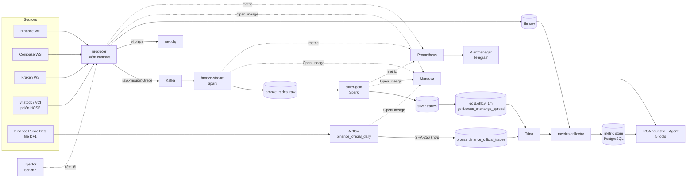

# FinObs

**FinObs** là nền tảng *data observability* cho dữ liệu tài chính thời gian thực. Hệ thống thu tick giao dịch từ
nhiều nguồn (Binance, Coinbase, VN30 qua vnstock), kiểm tra dữ liệu theo data contract, tính các metric chất lượng
(độ tươi, khối lượng, phân phối...) và dùng một agent LLM để chẩn đoán nguyên nhân gốc khi dữ liệu hỏng âm thầm
(*silent data failures*): trùng lặp, đổi schema, lệch đồng hồ, dữ liệu cũ...

> Trạng thái: đang phát triển, đã xong **Sprint 4** (đối soát D+1 Binance, gap detection, sketch profiling, SLO burn rate, gộp sự cố RCA, injector v2 & MTTD harness, backup/restore). Xem [Trạng thái dự án](#trạng-thái-dự-án).

---

## Mục lục

- [Kiến trúc](#kiến-trúc)
- [Trạng thái dự án](#trạng-thái-dự-án)
- [Cấu trúc thư mục](#cấu-trúc-thư-mục)
- [Cài đặt](#cài-đặt)
- [Khởi chạy hạ tầng](#khởi-chạy-hạ-tầng)
- [Sử dụng](#sử-dụng)
- [Quy ước dữ liệu](#quy-ước-dữ-liệu)
- [Kiểm thử và CI](#kiểm-thử-và-ci)
- [Quy trình đóng góp](#quy-trình-đóng-góp)
- [Tài liệu](#tài-liệu)

---

## Kiến trúc



Đã hoàn thiện (Sprint 4): 3 sàn crypto + vnstock → Kafka → bronze → silver → gold, DAG nạp & đối soát D+1 file chính thức,
metric 5 trụ cột + completeness/reconciliation + sketch profiling + SLO burn rate, OpenLineage từ mọi job, gộp sự cố & xếp hạng RCA, injector v2 + MTTD harness, backup/restore.
Chưa có: detector C1, vòng lặp LLM agent hoàn chỉnh, benchmark ≥ 100 kịch bản.

## Trạng thái dự án

| Mảng | Đã có | Chưa có |
|---|---|---|
| **Hạ tầng** | Compose 25 service chia profile (lõi / `ops` / `timesync`), `mem_limit` từng service; init tự động; Alertmanager → Telegram; DAG bảo trì Iceberg & đối soát D+1; script backup/restore & runbook; Helm phác thảo; CI build image + chạy test Spark | Template Helm cho các thành phần còn lại, cấu hình production |
| **Ingest** | Producer 24/7: Binance, Coinbase, **Kraken** (WS) và vnstock (poll trong phiên HOSE); kiểm contract từng bản ghi (vi phạm → `raw.dlq`); đo NTP | Schema riêng cho vnstock |
| **Data contract** | Contract 1.1.0 + contract Sprint 4 (`gap_detection`, `reconciliation`, `sketch_profiling`); **bronze bị khóa** trong đợt thu ([quy định](docs/conventions/bronze-freeze.md), CI chặn) | Contract cho bảng silver/gold |
| **Xử lý dữ liệu** | Bronze (trigger 60 s); **silver** (DECIMAL, taker side, `symbol_std`, khử trùng, bỏ bản ghi trễ > 10 phút); **gold** OHLCV 1 phút, VWAP, spread 3 sàn; `make reprocess` tính lại từ đầu bronze | vnstock silver (`vn_quotes`), dbt |
| **Lineage** | Mọi job phát OpenLineage về Marquez theo [quy ước tên](docs/conventions/lineage-naming.md) | Facet chi tiết (schema, số dòng) |
| **Giám sát** | Pipeline health (Kafka lag, thời gian micro-batch, job đứng, gold cũ, DAG lỗi); alert hạ tầng (`infra-alerts`) & **SLO burn rate** (`slo-burn-rate-alerts`) | Dashboard pipeline health trên Grafana |
| **Observability dữ liệu** | 5 trụ cột + **gap detection** & **đối soát D+1 Binance**, **sketch profiling**, **SLO engine** (`slos.yaml`), **gộp sự cố** (`incident_grouper`) | Detector C1 |
| **Agent / RCA** | **RCA heuristic** theo lineage (đúng top-1 trên S002); `impact_bfs`, `priority_ranker`; `query_metric`, `get_contract_violations`, `get_job_runs`, `get_lineage` đọc dữ liệu thật | Vòng lặp LLM agent, `list_alerts` thật (cần detector) |
| **Evaluation** | **Injector v1 & v2**, **MTTD harness** (`mttd_harness.py`), `benchmark_split.yaml`, scenario v1/v2 | Benchmark ≥ 100 kịch bản |
| **API / Dashboard nghiệp vụ** | — | Chưa bắt đầu |

**Sprint 4**: xem [docs/sprint4/reconciliation.md](docs/sprint4/reconciliation.md), [docs/sprint4/evaluation-v2.md](docs/sprint4/evaluation-v2.md) và [docs/sprint4-de-handoff.md](docs/sprint4-de-handoff.md).

**Sprint 3**: xem [docs/sprint3/summary.md](docs/sprint3/summary.md).

**Sprint 2** (25/11/2026): giá live của 20 mã trên bảng bronze với độ trễ khoảng 15 giây; 9,2 triệu trade chính thức
ngày 24/11 đã nạp, dãy trade ID liền mạch. Chi tiết trong [docs/sprint2/summary.md](docs/sprint2/summary.md).

**Sprint 1** (thu thật 60 phút, 2026-10-27): 231 859 trade từ 20 mã, 100% đạt contract. Độ trễ p50/p99: Binance
7/42 ms, Coinbase 160/272 ms. Chi tiết trong [docs/sprint1/summary.md](docs/sprint1/summary.md).

## Cấu trúc thư mục

```text
finobs/
├── agent/tools/          # 5 tool cho agent, schema JSON, client Marquez, backend metric store, dữ liệu giả
├── config/symbols.json   # Danh sách mã theo từng nguồn
├── docs/                 # Báo cáo sprint, quy ước, hướng dẫn hạ tầng, ghi chú paper, báo cáo LaTeX
├── evaluation/           # Fault taxonomy, scenario YAML (v1, v2), validator, handoff Sprint 2
├── infra/
│   ├── docker-compose.yml
│   ├── app/              # Image finobs-app: producer, metrics-collector, pipeline-exporter
│   ├── spark/            # Image finobs-spark: Spark + connector Kafka + Iceberg
│   ├── airflow/          # Image finobs-airflow (pyiceberg) và dags/
│   ├── configs/          # Marquez, Prometheus (+ alert), Alertmanager, Grafana, Spark, Trino
│   └── helm/finobs/      # Helm chart phác thảo
├── observability/        # Metric catalog, collector, SLO lịch giao dịch, RCA heuristic, SQL metric store
├── platform/
│   ├── contracts/        # JSON Schema cho raw event + validate.py
│   ├── ingest/           # Adapter từng sàn, producer Kafka, clock_check, analyze
│   ├── streaming/        # Spark: Kafka -> bronze, bronze -> silver -> gold, exporter pipeline health
│   ├── batch/            # Nạp file chính thức Binance, bảo trì Iceberg
│   └── lineage.py        # Phát OpenLineage về Marquez
├── reports/              # Bảng đo và biểu đồ do `make analyze` sinh ra
├── tests/                # Unit test và fixture
├── Makefile
└── requirements-*.txt    # ingest, runtime (image), test, observability, eval
```

Các thư mục chỉ chứa `.gitkeep` (`api/`, `dashboards/`, `platform/dbt/`...) là chỗ dành sẵn cho các sprint sau.

## Cài đặt

### Yêu cầu

- Git, GNU Make
- Docker Engine hoặc Docker Desktop, kèm Docker Compose. Chạy toàn bộ stack nên cấp cho Docker ít nhất 8 GB RAM
  (riêng FinObs dùng khoảng 4,5–5 GB khi cả Airflow đang nạp file).
- Python 3.11 trở lên (để chạy test và công cụ trên máy)
- Helm 3 (chỉ khi làm việc với Helm chart)

Trên Windows nên dùng **WSL2 Ubuntu** và bật Docker Desktop WSL integration.

```bash
git --version && docker --version && docker compose version && make --version && python3 --version
docker info   # Docker daemon phải đang chạy
```

### Các bước

```bash
git clone https://github.com/tattu1812/finobs.git
cd finobs

cp .env.example .env      # rồi đổi toàn bộ mật khẩu
make venv                 # tạo .venv, cài requirements-ingest.txt + requirements-test.txt
```

### Biến môi trường (`.env`)

| Biến | Mặc định | Ý nghĩa |
|---|---|---|
| `COMPOSE_PROJECT_NAME` | `finobs` | Tên project Docker Compose |
| `KAFKA_PORT` | `9092` | Cổng Kafka cho client trên máy host |
| `MINIO_API_PORT` / `MINIO_CONSOLE_PORT` | `9000` / `9001` | API và giao diện MinIO |
| `MINIO_ROOT_USER` / `MINIO_ROOT_PASSWORD` | `finobs` / `change_me_before_use` | Tài khoản MinIO, dùng chung cho Iceberg, Trino, Spark, Airflow |
| `SPARK_UI_PORT` | `8082` | Spark Master UI |
| `SPARK_WORKER_CORES` / `SPARK_WORKER_MEMORY` | `2` / `2G` | Tài nguyên Spark worker |
| `BRONZE_TRIGGER_SECONDS` | `60` | Chu kỳ micro-batch Kafka → bronze (60 s để ít file nhỏ) |
| `PRODUCER_SOURCES` | `binance,coinbase,kraken,vnstock` | Nguồn producer chạy (vnstock chỉ poll trong phiên HOSE) |
| `SILVER_TRIGGER_SECONDS` | `60` | Chu kỳ micro-batch bronze → silver → gold |
| `ALERTMANAGER_PORT` | `9093` | Giao diện Alertmanager |
| `TELEGRAM_BOT_TOKEN` / `TELEGRAM_CHAT_ID` | trống | Có thì Alertmanager gửi cảnh báo vào Telegram; trống thì chỉ ghi nhận |
| `AIRFLOW_PORT` | `8080` | Airflow Web UI |
| `AIRFLOW_DB_PASSWORD` | `change_me_before_use` | Mật khẩu PostgreSQL của Airflow |
| `AIRFLOW_ADMIN_PASSWORD` | `change_me_before_use` | Mật khẩu tài khoản `admin` Airflow (tạo tự động). **Bắt buộc** |
| `MARQUEZ_DB_PASSWORD` | `change_me` | Mật khẩu PostgreSQL của Marquez |
| `METRICS_DB_PORT` | `5435` | Cổng metric store trên máy host |
| `METRICS_DB_PASSWORD` | `change_me_before_use` | Mật khẩu metric store (user `finobs`). **Bắt buộc** |
| `GRAFANA_ADMIN_PASSWORD` | `change-me-for-local-development` | Mật khẩu `admin` của Grafana. **Bắt buộc** |

Thiếu biến bắt buộc thì `make check` báo lỗi. Không commit `.env` hay mật khẩu thật lên GitHub. Khi `.env.example`
có biến mới, nhớ chép biến đó sang `.env` của bạn.

## Khởi chạy hạ tầng

```bash
make check     # kiểm tra cấu hình Docker Compose
make up        # build 3 image (lần đầu vài phút), chạy lõi + profile ops
make up-core   # chỉ phần lõi (máy ít RAM): thu, bronze/silver/gold, metric, alert
make timesync  # chỉ trên Docker Desktop: đồng bộ giờ máy ảo bằng NTP
make ps        # xem trạng thái container
```

| Profile | Service | Khi nào cần |
|---|---|---|
| (lõi, luôn chạy) | Kafka, MinIO, Iceberg REST, Trino, Spark, `producer`, `bronze-stream`, `silver-gold`, metric store, collector, Prometheus, Alertmanager | Luôn luôn: đây là phần thu 24/7 |
| `ops` | Airflow, Marquez, Grafana, `pipeline-exporter` | Nạp file chính thức hằng ngày, lineage, dashboard |
| `timesync` | `timesync` (ntpd, quyền `SYS_TIME`) | Docker Desktop trên Windows/macOS: đồng hồ máy ảo trôi. **Không** dùng trên máy chủ Linux |

Không có bước làm tay: bucket `finobs-warehouse`, các topic Kafka, bảng Iceberg và tài khoản admin Airflow đều được
tạo tự động. Các container `*-init` dừng với `Exited (0)` là bình thường.

### Dịch vụ và cổng

| Dịch vụ | Địa chỉ trên máy host | Ghi chú |
|---|---|---|
| Kafka | `localhost:9092` | Trong mạng Docker: `kafka:29092`. Topic `raw.binance.trade`, `raw.coinbase.trade`, `raw.dlq` |
| MinIO API / Console | <http://localhost:9000> / <http://localhost:9001> | Đăng nhập bằng `MINIO_ROOT_USER` / `MINIO_ROOT_PASSWORD` |
| Spark Master | `spark://localhost:7077`, UI <http://localhost:8082> | Ứng dụng `finobs-bronze-trades` chạy thường trực |
| Iceberg REST Catalog | <http://localhost:8181> | Catalog lưu trong SQLite (volume `iceberg_catalog_data`) |
| Trino | <http://localhost:8081> | Catalog `iceberg` |
| Airflow | <http://localhost:8080> | `admin` / `AIRFLOW_ADMIN_PASSWORD`; DAG `binance_official_daily` |
| Marquez API | <http://localhost:5000> | Chưa có Web UI |
| Metric store (PostgreSQL) | `localhost:5435` | DB `finobs_metrics`, user `finobs`, bảng `metric_observations` |
| Prometheus | <http://localhost:9090> | Thu metric Spark, producer, Airflow; alert trong `infra/configs/prometheus/rules/` |
| Alertmanager | <http://localhost:9093> | Gửi alert vào Telegram nếu đặt `TELEGRAM_*` |
| Grafana | <http://localhost:3000> | `admin` / `GRAFANA_ADMIN_PASSWORD`; thư mục *FinObs* có 2 dashboard |

Dịch vụ nội bộ không mở cổng: `producer` (metric `producer:8000`), `bronze-stream` và `silver-gold` (metric `:9108`),
`metrics-collector`, `pipeline-exporter` (`:8001`).

### Kiểm tra nhanh

```bash
make bronze-check        # giá live trên bronze.trades_raw: số dòng và độ trễ theo nguồn
make gold-check          # gold có tính đúng không: đếm lại từ silver, mismatched_minutes phải = 0
make official-check      # file chính thức đã nạp: số trade, dãy ID theo ngày và mã
docker logs finobs-producer --tail 5
docker exec finobs-metrics-postgres psql -U finobs -d finobs_metrics \
  -c "SELECT metric_name, status, count(*) FROM metric_observations GROUP BY 1, 2"
```

### Dừng và dữ liệu

`make stop` dừng container; `make down` xóa container nhưng **giữ volume** (Kafka, MinIO, catalog Iceberg, các
PostgreSQL, file raw, checkpoint Spark, Prometheus, Grafana). Không dùng `docker compose down -v` nếu cần giữ dữ liệu.

Cấu hình hiện tại chỉ dành cho môi trường phát triển và demo, chưa phải production.

## Sử dụng

### Pipeline

| Thành phần | Mã nguồn | Ghi chú |
|---|---|---|
| Producer | [platform/ingest/produce.py](platform/ingest/produce.py) | WebSocket → kiểm contract → Kafka (khóa = mã sàn); ghi thêm file raw cho collector |
| Bronze stream | [platform/streaming/bronze_trades.py](platform/streaming/bronze_trades.py) | Kafka → `iceberg.bronze.trades_raw`, phân vùng theo `source, days(event_ts)`, chỉ ghi thêm |
| Silver + gold | [platform/streaming/silver_gold.py](platform/streaming/silver_gold.py) | Bronze → silver (MERGE khử trùng) → gold (tính lại phút bị ảnh hưởng); `--mode rebuild` cùng code |
| File chính thức | [platform/batch/binance_official.py](platform/batch/binance_official.py) | Tải + kiểm SHA-256 + nạp; idempotent theo `(file_date, symbol)` |
| Bảo trì Iceberg | [platform/batch/iceberg_maintenance.py](platform/batch/iceberg_maintenance.py) | DAG `iceberg_maintenance` 04:30 UTC: optimize, expire_snapshots 7 ngày, xóa file mồ côi |
| DAG | [infra/airflow/dags/binance_official_daily.py](infra/airflow/dags/binance_official_daily.py) | 03:30 UTC hằng ngày nạp file ngày hôm trước |

```bash
make load-official DATE=2026-11-24       # nạp tay một ngày (backfill)
make reprocess FROM=2026-11-27           # tính lại silver/gold từ bronze (bỏ FROM/TO = toàn bộ)
make completeness-check DATE=2026-11-27  # stream có đủ không: gold Binance so với file chính thức (C2)
make bench                               # chạy injector trên mọi scenario, kết quả vào bench/
```

### Thu file để đo đạc (Sprint 1)

```bash
make record MINUTES=60              # chạy clock-check trước, rồi thu Binance + Coinbase ra file
make record SOURCES=vnstock         # chỉ chạy được trong giờ giao dịch HOSE
make analyze                        # sinh bảng đo và biểu đồ vào reports/
```

Trước khi thu phải đồng bộ giờ hệ thống: `clock_check` sẽ chặn nếu đồng hồ lệch quá 250 ms.

### Kiểm tra contract và scenario

```bash
make validate-contracts             # validate data/raw (nếu chưa có thì dùng fixtures) + các ca lỗi cố ý
make validate-scenarios             # scenario v2, scenario v1 cũ, ca lỗi cố ý, unit test
```

### Observability và agent

```bash
python observability/collectors/run_loop.py --raw data/raw --once --dry-run    # xem trước metric, không cần DB
make lineage                                            # đồ thị lineage kèm alert (Marquez giả)
make lineage MARQUEZ_URL=http://localhost:5000          # dùng Marquez thật
```

Xem [observability/collectors/README.md](observability/collectors/README.md) và [agent/tools/README.md](agent/tools/README.md).

### Tất cả lệnh Make

| Lệnh | Công dụng |
|---|---|
| `make help` | Liệt kê các lệnh |
| `make check` / `build` / `up` / `ps` / `logs` / `stop` / `restart` / `down` | Quản lý Docker Compose |
| `make up-core` / `timesync` | Chỉ phần lõi; đồng bộ giờ Docker Desktop |
| `make bronze-check` / `official-check` / `gold-check` / `completeness-check` | Kiểm tra nhanh qua Trino |
| `make reprocess FROM= TO=` | Tính lại silver/gold từ bronze |
| `make bench` | Chạy injector trên các scenario |
| `make load-official DATE=...` | Nạp file chính thức Binance của một ngày |
| `make reconcile DATE=...` | Đối soát D+1 stream vs file chính thức Binance (`SYMBOLS`, `FROM`, `TO`, `FIXTURE_DIR`) |
| `make venv` | Tạo `.venv` và cài dependency cho ingest + test |
| `make clock-check` / `record` / `analyze` | Đo đồng hồ, thu file, sinh bảng đo (Sprint 1) |
| `make validate-contracts` / `validate-scenarios` | Validate data contract và scenario |
| `make test` | Mọi unit test (`test-platform`, `test-observability`, `test-agent`, `test-reconcile`, `test-sprint4`) |
| `make test-spark` | Logic silver/gold trên Spark local (trong image `finobs-spark`) |
| `make lineage` | In đồ thị lineage |

> **Lưu ý:** script trong `platform/` phải chạy bằng đường dẫn file (`python platform/ingest/record.py`), không dùng
> `python -m platform...`, vì tên `platform` trùng với một module chuẩn của Python. Riêng package `agent` thì chạy
> bằng `python -m agent...` từ gốc repo.

## Quy ước dữ liệu

Mọi thành phần đọc dữ liệu raw đều phải tuân theo các quy ước sau:

- **Khử trùng theo `event_id`.** Bỏ các bản ghi có `transport.is_snapshot = true` khi tính chỉ số realtime.
- **Giá và khối lượng là string** trong raw. Parse bằng `Decimal` / `DECIMAL(38,18)`, không dùng `float`.
- **Thời gian** dùng UTC, ISO 8601, độ chính xác mili giây, hậu tố `Z`.
- **Mã chuẩn hóa** có dạng `BASE-QUOTE`. `BTC-USDT` (Binance) và `BTC-USD` (Coinbase) là hai cặp khác nhau.
- **Watermark riêng cho từng nguồn:** Binance 0–200 ms, Coinbase 500 ms, vnstock khoảng 10 s.
- **Sửa schema** thì phải tăng `SCHEMA_VERSION` trong cùng PR, theo SemVer
  (xem [platform/contracts/README.md](platform/contracts/README.md)).
- **Bronze bị khóa** trong đợt thu 14 ngày: sửa producer, adapter sàn, contract, job bronze hay danh sách mã phải qua
  review riêng và nhãn `bronze-change-approved` (xem [docs/conventions/bronze-freeze.md](docs/conventions/bronze-freeze.md)).
- **Mã chuẩn:** `symbol_canonical` giữ đúng cặp (BTC-USDT ≠ BTC-USD); `symbol_std` (BTC/USD) coi USDT, USDC như USD để so liên sàn.
- **Tên dataset trong lineage** trùng tên topic Kafka / bảng Iceberg
  (xem [docs/conventions/lineage-naming.md](docs/conventions/lineage-naming.md)).
- **Đồng hồ:** độ trễ ingest chỉ đúng khi đồng hồ máy chạy producer lệch dưới 250 ms. Xem panel lệch đồng hồ trên
  Grafana và alert `ClockSkew` trước khi tin số đo độ trễ.

## Kiểm thử và CI

GitHub Actions ([.github/workflows/ci.yml](.github/workflows/ci.yml)) chạy trên mỗi push và PR vào `main`:

1. `ruff check .`
2. `make validate-contracts` trên fixtures
3. `make validate-scenarios` (v2, v1, ca lỗi, unit test)
4. `make test-platform`, `make test-agent`, `make test-observability`
5. Kiểm tra cấu hình Docker Compose và build cả 3 image
6. `helm lint` và `helm template` cho `infra/helm/finobs`

Chạy lại ở máy local trước khi mở PR:

```bash
.venv/bin/pip install ruff==0.9.10
.venv/bin/ruff check .
make validate-contracts validate-scenarios test
make check
helm lint infra/helm/finobs        # nếu có sửa Helm chart
```

## Quy trình đóng góp

- Nhánh `main` được bảo vệ: PR cần **ít nhất 1 approve** và **CI xanh** mới được merge.
- Tạo nhánh riêng cho mỗi việc, không push thẳng lên `main`.
- Commit message nên theo dạng `type(scope): mô tả`, ví dụ `feat(ingest): ...`, `docs(s1): ...`.
- Không commit `.env`, `data/`, `.venv/` hay file `__pycache__`.
- Thêm biến môi trường mới thì cập nhật cả `.env.example` và bảng biến môi trường trong README.

## Tài liệu

| Tài liệu | Nội dung |
|---|---|
| [docs/sprint3/summary.md](docs/sprint3/summary.md) | Tóm tắt Sprint 3: khóa hạ tầng, số liệu, phát hiện |
| [docs/sprint2/summary.md](docs/sprint2/summary.md) | Tóm tắt Sprint 2: pipeline end-to-end, số liệu, phát hiện |
| [docs/conventions/bronze-freeze.md](docs/conventions/bronze-freeze.md) | Quy định khóa bronze trong đợt thu 14 ngày |
| [docs/sprint4/reconciliation.md](docs/sprint4/reconciliation.md) | Sprint 4: Gap detection & Đối soát D+1 Binance |
| [docs/sprint4-de-handoff.md](docs/sprint4-de-handoff.md) | Sprint 4: Bàn giao DE cho OB, AI và EV |
| [docs/sprint1/summary.md](docs/sprint1/summary.md) | Tóm tắt Sprint 1 trong một trang |
| [docs/sprint1/report.md](docs/sprint1/report.md) | Báo cáo đầy đủ Sprint 1 |
| [docs/conventions/lineage-naming.md](docs/conventions/lineage-naming.md) | Quy ước tên dataset/job trong lineage và scenario |
| [docs/airflow-marquez.md](docs/airflow-marquez.md) | Airflow, Marquez, OpenLineage, DAG `binance_official_daily` |
| [docs/monitoring.md](docs/monitoring.md) | Prometheus, Grafana, alert rules |
| [infra/helm/finobs/README.md](infra/helm/finobs/README.md) | Helm chart phác thảo |
| [docs/papers/](docs/papers/) | Ghi chú paper Dataflow Model và Lakehouse |
| [platform/contracts/README.md](platform/contracts/README.md) | Data contract tầng raw |
| [observability/metric_catalog.yaml](observability/metric_catalog.yaml) | Định nghĩa metric |
| [observability/collectors/README.md](observability/collectors/README.md) | Collector metric chạy liên tục |
| [agent/tools/README.md](agent/tools/README.md) | Tool của agent chẩn đoán |
| [evaluation/fault_taxonomy.md](evaluation/fault_taxonomy.md) | Phân loại lỗi FT01–FT12 |
| [evaluation/scenarios/README.md](evaluation/scenarios/README.md) | Hướng dẫn viết scenario |
| [evaluation/scenarios/MIGRATION_v1_to_v2.md](evaluation/scenarios/MIGRATION_v1_to_v2.md) | Chuyển scenario v1 sang v2 |
| [evaluation/SPRINT2_REVIEW_HANDOFF.md](evaluation/SPRINT2_REVIEW_HANDOFF.md) | Bàn giao và quyết định D01–D05 của Sprint 2 |
