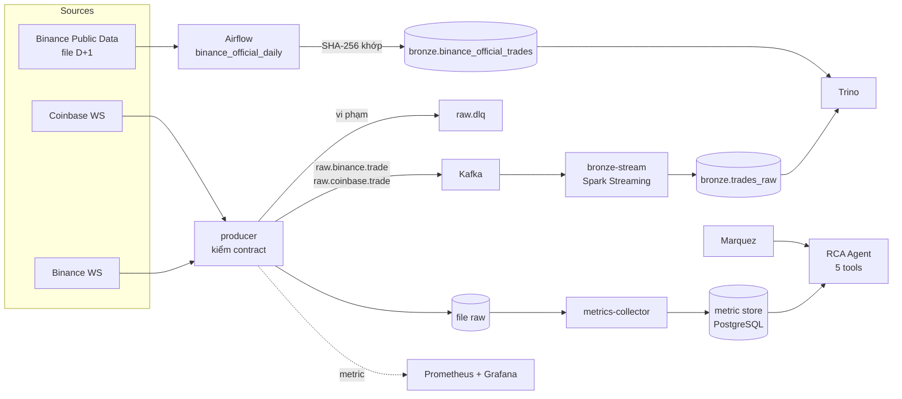

# FinObs

**FinObs** là nền tảng *data observability* cho dữ liệu tài chính thời gian thực. Hệ thống thu tick giao dịch từ
nhiều nguồn (Binance, Coinbase, VN30 qua vnstock), kiểm tra dữ liệu theo data contract, tính các metric chất lượng
(độ tươi, khối lượng, phân phối...) và dùng một agent LLM để chẩn đoán nguyên nhân gốc khi dữ liệu hỏng âm thầm
(*silent data failures*): trùng lặp, đổi schema, lệch đồng hồ, dữ liệu cũ...

> Trạng thái: đang phát triển, đã xong **Sprint 2** (dữ liệu chạy end-to-end tới bronze). Xem [Trạng thái dự án](#trạng-thái-dự-án).

---

## Mục lục

- [Kiến trúc](#kiến-trúc)
- [Trạng thái dự án](#trạng-thái-dự-án)
- [Cấu trúc thư mục](#cấu-trúc-thư-mục)
- [Cài đặt](#cài-đặt)
- [Khởi chạy hạ tầng](#khởi-chạy-hạ-tầng)
- [Sử dụng](#sử-dụng)
- [Quy ước dữ liệu](#quy-ước-dữ-liệu)
- [Kiểm thử và CI](#kiểm-thử-và-ci)
- [Quy trình đóng góp](#quy-trình-đóng-góp)
- [Tài liệu](#tài-liệu)

---

## Kiến trúc



Đã chạy thật (Sprint 2): producer → Kafka → Spark → Iceberg bronze, DAG nạp file chính thức Binance,
collector ghi 3 metric vào metric store, agent đọc metric store. Chưa có: silver/gold, OpenLineage tự động,
detector, vòng lặp agent, injector và benchmark (xem bảng dưới).

## Trạng thái dự án

| Mảng | Đã có | Chưa có |
|---|---|---|
| **Hạ tầng** | Docker Compose 21 service (Kafka, MinIO, Spark, Iceberg REST, Trino, Airflow, Marquez, Prometheus, Grafana, metric store...); bucket, topic, tài khoản Airflow tạo tự động; Helm chart phác thảo; CI build image | Template Helm cho các thành phần còn lại, cấu hình production |
| **Ingest** | Producer WebSocket → Kafka chạy liên tục, tự kết nối lại, kiểm contract từng bản ghi (vi phạm → `raw.dlq`), đo lệch đồng hồ NTP; recorder file + `analyze` (S1) | vnstock vào Kafka |
| **Data contract** | 3 JSON Schema, `validate.py`, 22 fixture lỗi; áp dụng ngay trong producer | Schema vnstock, contract cho bảng silver/gold |
| **Xử lý dữ liệu** | Spark Structured Streaming Kafka → `bronze.trades_raw` (exactly-once); DAG `binance_official_daily` → `bronze.binance_official_trades` | Silver (chuẩn hóa, khử trùng), gold (OHLCV, VWAP, spread), dbt |
| **Lineage** | Marquez nhận OpenLineage (thử bằng API); [quy ước đặt tên](docs/conventions/lineage-naming.md) thống nhất | Spark/Airflow tự phát lineage |
| **Giám sát** | Dashboard hạ tầng + dashboard ingest; alert Spark down, producer down, nguồn ngừng, vi phạm contract, lệch đồng hồ | Gửi thông báo (Alertmanager) |
| **Observability dữ liệu** | Metric store chạy thật; collector liên tục cho `trade_count_1m`, `ingest_delay_p95_ms`, `last_live_trade_age_seconds` | Detector, SLO, đối soát C2, cross-source C1, incident |
| **Agent** | 5 tool + JSON schema; `query_metric` đọc metric store thật; lineage đọc Marquez | Prompt, vòng lặp gọi LLM, 3 tool còn lại trên dữ liệu thật |
| **Evaluation** | Taxonomy FT01–FT12; scenario v2 (v1 vẫn hỗ trợ); 4 kịch bản; validator theo phiên bản | Injector, bench, kết quả |
| **API / Dashboard nghiệp vụ** | — | Chưa bắt đầu |

**Sprint 2** (25/11/2026): giá live của 20 mã trên bảng bronze với độ trễ khoảng 15 giây; 9,2 triệu trade chính thức
ngày 24/11 đã nạp, dãy trade ID liền mạch. Chi tiết trong [docs/sprint2/summary.md](docs/sprint2/summary.md).

**Sprint 1** (thu thật 60 phút, 2026-10-27): 231 859 trade từ 20 mã, 100% đạt contract. Độ trễ p50/p99: Binance
7/42 ms, Coinbase 160/272 ms. Chi tiết trong [docs/sprint1/summary.md](docs/sprint1/summary.md).

## Cấu trúc thư mục

```text
finobs/
├── agent/tools/          # 5 tool cho agent, schema JSON, client Marquez, backend metric store, dữ liệu giả
├── config/symbols.json   # Danh sách mã theo từng nguồn
├── docs/                 # Báo cáo sprint, quy ước, hướng dẫn hạ tầng, ghi chú paper, báo cáo LaTeX
├── evaluation/           # Fault taxonomy, scenario YAML (v1, v2), validator, handoff Sprint 2
├── infra/
│   ├── docker-compose.yml
│   ├── app/              # Image finobs-app: producer + metrics-collector
│   ├── spark/            # Image finobs-spark: Spark + connector Kafka + Iceberg
│   ├── airflow/          # Image finobs-airflow (pyiceberg) và dags/
│   ├── configs/          # Marquez, Prometheus (+ alert), Grafana (dashboard), Spark, Trino
│   └── helm/finobs/      # Helm chart phác thảo
├── observability/        # Metric catalog, collector, SQL cho metric store
├── platform/
│   ├── contracts/        # JSON Schema cho raw event + validate.py
│   ├── ingest/           # Recorder WebSocket, producer Kafka, clock_check, analyze
│   ├── streaming/        # Spark Structured Streaming: Kafka -> bronze
│   └── batch/            # Nạp file chính thức Binance (kiểm SHA-256) -> bronze
├── reports/              # Bảng đo và biểu đồ do `make analyze` sinh ra
├── tests/                # Unit test và fixture
├── Makefile
└── requirements-*.txt    # ingest, runtime (image), test, observability, eval
```

Các thư mục chỉ chứa `.gitkeep` (`api/`, `dashboards/`, `platform/dbt/`...) là chỗ dành sẵn cho các sprint sau.

## Cài đặt

### Yêu cầu

- Git, GNU Make
- Docker Engine hoặc Docker Desktop, kèm Docker Compose. Chạy toàn bộ stack nên cấp cho Docker ít nhất 8 GB RAM
  (riêng FinObs dùng khoảng 4,5–5 GB khi cả Airflow đang nạp file).
- Python 3.11 trở lên (để chạy test và công cụ trên máy)
- Helm 3 (chỉ khi làm việc với Helm chart)

Trên Windows nên dùng **WSL2 Ubuntu** và bật Docker Desktop WSL integration.

```bash
git --version && docker --version && docker compose version && make --version && python3 --version
docker info   # Docker daemon phải đang chạy
```

### Các bước

```bash
git clone https://github.com/tattu1812/finobs.git
cd finobs

cp .env.example .env      # rồi đổi toàn bộ mật khẩu
make venv                 # tạo .venv, cài requirements-ingest.txt + requirements-test.txt
```

### Biến môi trường (`.env`)

| Biến | Mặc định | Ý nghĩa |
|---|---|---|
| `COMPOSE_PROJECT_NAME` | `finobs` | Tên project Docker Compose |
| `KAFKA_PORT` | `9092` | Cổng Kafka cho client trên máy host |
| `MINIO_API_PORT` / `MINIO_CONSOLE_PORT` | `9000` / `9001` | API và giao diện MinIO |
| `MINIO_ROOT_USER` / `MINIO_ROOT_PASSWORD` | `finobs` / `change_me_before_use` | Tài khoản MinIO, dùng chung cho Iceberg, Trino, Spark, Airflow |
| `SPARK_UI_PORT` | `8082` | Spark Master UI |
| `SPARK_WORKER_CORES` / `SPARK_WORKER_MEMORY` | `2` / `2G` | Tài nguyên Spark worker |
| `BRONZE_TRIGGER_SECONDS` | `15` | Chu kỳ micro-batch Kafka → bronze |
| `PRODUCER_SOURCES` | `binance,coinbase` | Nguồn WebSocket producer chạy |
| `AIRFLOW_PORT` | `8080` | Airflow Web UI |
| `AIRFLOW_DB_PASSWORD` | `change_me_before_use` | Mật khẩu PostgreSQL của Airflow |
| `AIRFLOW_ADMIN_PASSWORD` | `change_me_before_use` | Mật khẩu tài khoản `admin` Airflow (tạo tự động). **Bắt buộc** |
| `MARQUEZ_DB_PASSWORD` | `change_me` | Mật khẩu PostgreSQL của Marquez |
| `METRICS_DB_PORT` | `5435` | Cổng metric store trên máy host |
| `METRICS_DB_PASSWORD` | `change_me_before_use` | Mật khẩu metric store (user `finobs`). **Bắt buộc** |
| `GRAFANA_ADMIN_PASSWORD` | `change-me-for-local-development` | Mật khẩu `admin` của Grafana. **Bắt buộc** |

Thiếu biến bắt buộc thì `make check` báo lỗi. Không commit `.env` hay mật khẩu thật lên GitHub. Khi `.env.example`
có biến mới, nhớ chép biến đó sang `.env` của bạn.

## Khởi chạy hạ tầng

```bash
make check     # kiểm tra cấu hình Docker Compose
make up        # build 3 image (lần đầu vài phút) và khởi chạy toàn bộ dịch vụ
make ps        # xem trạng thái container
```

Không có bước làm tay: bucket `finobs-warehouse`, các topic Kafka, bảng Iceberg và tài khoản admin Airflow đều được
tạo tự động. Các container `*-init` dừng với `Exited (0)` là bình thường.

### Dịch vụ và cổng

| Dịch vụ | Địa chỉ trên máy host | Ghi chú |
|---|---|---|
| Kafka | `localhost:9092` | Trong mạng Docker: `kafka:29092`. Topic `raw.binance.trade`, `raw.coinbase.trade`, `raw.dlq` |
| MinIO API / Console | <http://localhost:9000> / <http://localhost:9001> | Đăng nhập bằng `MINIO_ROOT_USER` / `MINIO_ROOT_PASSWORD` |
| Spark Master | `spark://localhost:7077`, UI <http://localhost:8082> | Ứng dụng `finobs-bronze-trades` chạy thường trực |
| Iceberg REST Catalog | <http://localhost:8181> | Catalog lưu trong SQLite (volume `iceberg_catalog_data`) |
| Trino | <http://localhost:8081> | Catalog `iceberg` |
| Airflow | <http://localhost:8080> | `admin` / `AIRFLOW_ADMIN_PASSWORD`; DAG `binance_official_daily` |
| Marquez API | <http://localhost:5000> | Chưa có Web UI |
| Metric store (PostgreSQL) | `localhost:5435` | DB `finobs_metrics`, user `finobs`, bảng `metric_observations` |
| Prometheus | <http://localhost:9090> | Thu metric Spark và producer; alert trong `infra/configs/prometheus/rules/` |
| Grafana | <http://localhost:3000> | `admin` / `GRAFANA_ADMIN_PASSWORD`; thư mục *FinObs* có 2 dashboard |

Dịch vụ nội bộ không mở cổng: `producer` (metric tại `producer:8000`), `bronze-stream`, `metrics-collector`.

### Kiểm tra nhanh

```bash
make bronze-check        # giá live trên bronze.trades_raw: số dòng và độ trễ theo nguồn
make official-check      # file chính thức đã nạp: số trade, dãy ID theo ngày và mã
docker logs finobs-producer --tail 5
docker exec finobs-metrics-postgres psql -U finobs -d finobs_metrics \
  -c "SELECT metric_name, status, count(*) FROM metric_observations GROUP BY 1, 2"
```

### Dừng và dữ liệu

`make stop` dừng container; `make down` xóa container nhưng **giữ volume** (Kafka, MinIO, catalog Iceberg, các
PostgreSQL, file raw, checkpoint Spark, Prometheus, Grafana). Không dùng `docker compose down -v` nếu cần giữ dữ liệu.

Cấu hình hiện tại chỉ dành cho môi trường phát triển và demo, chưa phải production.

## Sử dụng

### Pipeline

| Thành phần | Mã nguồn | Ghi chú |
|---|---|---|
| Producer | [platform/ingest/produce.py](platform/ingest/produce.py) | WebSocket → kiểm contract → Kafka (khóa = mã sàn); ghi thêm file raw cho collector |
| Bronze stream | [platform/streaming/bronze_trades.py](platform/streaming/bronze_trades.py) | Kafka → `iceberg.bronze.trades_raw`, phân vùng theo `source, days(event_ts)`, chỉ ghi thêm |
| File chính thức | [platform/batch/binance_official.py](platform/batch/binance_official.py) | Tải + kiểm SHA-256 + nạp; idempotent theo `(file_date, symbol)` |
| DAG | [infra/airflow/dags/binance_official_daily.py](infra/airflow/dags/binance_official_daily.py) | 03:30 UTC hằng ngày nạp file ngày hôm trước |

```bash
make load-official DATE=2026-11-24       # nạp tay một ngày (backfill)
```

### Thu file để đo đạc (Sprint 1)

```bash
make record MINUTES=60              # chạy clock-check trước, rồi thu Binance + Coinbase ra file
make record SOURCES=vnstock         # chỉ chạy được trong giờ giao dịch HOSE
make analyze                        # sinh bảng đo và biểu đồ vào reports/
```

Trước khi thu phải đồng bộ giờ hệ thống: `clock_check` sẽ chặn nếu đồng hồ lệch quá 250 ms.

### Kiểm tra contract và scenario

```bash
make validate-contracts             # validate data/raw (nếu chưa có thì dùng fixtures) + các ca lỗi cố ý
make validate-scenarios             # scenario v2, scenario v1 cũ, ca lỗi cố ý, unit test
```

### Observability và agent

```bash
python observability/collectors/run_loop.py --raw data/raw --once --dry-run    # xem trước metric, không cần DB
make lineage                                            # đồ thị lineage kèm alert (Marquez giả)
make lineage MARQUEZ_URL=http://localhost:5000          # dùng Marquez thật
```

Xem [observability/collectors/README.md](observability/collectors/README.md) và [agent/tools/README.md](agent/tools/README.md).

### Tất cả lệnh Make

| Lệnh | Công dụng |
|---|---|
| `make help` | Liệt kê các lệnh |
| `make check` / `build` / `up` / `ps` / `logs` / `stop` / `restart` / `down` | Quản lý Docker Compose |
| `make bronze-check` / `official-check` | Truy vấn nhanh hai bảng bronze qua Trino |
| `make load-official DATE=...` | Nạp file chính thức Binance của một ngày |
| `make reconcile DATE=...` | Đối soát D+1 stream vs file chính thức Binance (`SYMBOLS`, `FROM`, `TO`, `FIXTURE_DIR`) |
| `make venv` | Tạo `.venv` và cài dependency cho ingest + test |
| `make clock-check` / `record` / `analyze` | Đo đồng hồ, thu file, sinh bảng đo (Sprint 1) |
| `make validate-contracts` / `validate-scenarios` | Validate data contract và scenario |
| `make test` | Mọi unit test (`test-platform`, `test-observability`, `test-agent`, `test-reconcile`) |
| `make lineage` | In đồ thị lineage |

> **Lưu ý:** script trong `platform/` phải chạy bằng đường dẫn file (`python platform/ingest/record.py`), không dùng
> `python -m platform...`, vì tên `platform` trùng với một module chuẩn của Python. Riêng package `agent` thì chạy
> bằng `python -m agent...` từ gốc repo.

## Quy ước dữ liệu

Mọi thành phần đọc dữ liệu raw đều phải tuân theo các quy ước sau:

- **Khử trùng theo `event_id`.** Bỏ các bản ghi có `transport.is_snapshot = true` khi tính chỉ số realtime.
- **Giá và khối lượng là string** trong raw. Parse bằng `Decimal` / `DECIMAL(38,18)`, không dùng `float`.
- **Thời gian** dùng UTC, ISO 8601, độ chính xác mili giây, hậu tố `Z`.
- **Mã chuẩn hóa** có dạng `BASE-QUOTE`. `BTC-USDT` (Binance) và `BTC-USD` (Coinbase) là hai cặp khác nhau.
- **Watermark riêng cho từng nguồn:** Binance 0–200 ms, Coinbase 500 ms, vnstock khoảng 10 s.
- **Sửa schema** thì phải tăng `SCHEMA_VERSION` trong cùng PR, theo SemVer
  (xem [platform/contracts/README.md](platform/contracts/README.md)).
- **Tên dataset trong lineage** trùng tên topic Kafka / bảng Iceberg
  (xem [docs/conventions/lineage-naming.md](docs/conventions/lineage-naming.md)).
- **Đồng hồ:** độ trễ ingest chỉ đúng khi đồng hồ máy chạy producer lệch dưới 250 ms. Xem panel lệch đồng hồ trên
  Grafana và alert `ClockSkew` trước khi tin số đo độ trễ.

## Kiểm thử và CI

GitHub Actions ([.github/workflows/ci.yml](.github/workflows/ci.yml)) chạy trên mỗi push và PR vào `main`:

1. `ruff check .`
2. `make validate-contracts` trên fixtures
3. `make validate-scenarios` (v2, v1, ca lỗi, unit test)
4. `make test-platform`, `make test-agent`, `make test-observability`
5. Kiểm tra cấu hình Docker Compose và build cả 3 image
6. `helm lint` và `helm template` cho `infra/helm/finobs`

Chạy lại ở máy local trước khi mở PR:

```bash
.venv/bin/pip install ruff==0.9.10
.venv/bin/ruff check .
make validate-contracts validate-scenarios test
make check
helm lint infra/helm/finobs        # nếu có sửa Helm chart
```

## Quy trình đóng góp

- Nhánh `main` được bảo vệ: PR cần **ít nhất 1 approve** và **CI xanh** mới được merge.
- Tạo nhánh riêng cho mỗi việc, không push thẳng lên `main`.
- Commit message nên theo dạng `type(scope): mô tả`, ví dụ `feat(ingest): ...`, `docs(s1): ...`.
- Không commit `.env`, `data/`, `.venv/` hay file `__pycache__`.
- Thêm biến môi trường mới thì cập nhật cả `.env.example` và bảng biến môi trường trong README.

## Tài liệu

| Tài liệu | Nội dung |
|---|---|
| [docs/sprint2/summary.md](docs/sprint2/summary.md) | Tóm tắt Sprint 2: pipeline end-to-end, số liệu, phát hiện |
| [docs/sprint4/reconciliation.md](docs/sprint4/reconciliation.md) | Sprint 4: Gap detection & Đối soát D+1 Binance |
| [docs/sprint4-de-handoff.md](docs/sprint4-de-handoff.md) | Sprint 4: Bàn giao DE cho OB, AI và EV |
| [docs/sprint1/summary.md](docs/sprint1/summary.md) | Tóm tắt Sprint 1 trong một trang |
| [docs/sprint1/report.md](docs/sprint1/report.md) | Báo cáo đầy đủ Sprint 1 |
| [docs/conventions/lineage-naming.md](docs/conventions/lineage-naming.md) | Quy ước tên dataset/job trong lineage và scenario |
| [docs/airflow-marquez.md](docs/airflow-marquez.md) | Airflow, Marquez, OpenLineage, DAG `binance_official_daily` |
| [docs/monitoring.md](docs/monitoring.md) | Prometheus, Grafana, alert rules |
| [infra/helm/finobs/README.md](infra/helm/finobs/README.md) | Helm chart phác thảo |
| [docs/papers/](docs/papers/) | Ghi chú paper Dataflow Model và Lakehouse |
| [platform/contracts/README.md](platform/contracts/README.md) | Data contract tầng raw |
| [observability/metric_catalog.yaml](observability/metric_catalog.yaml) | Định nghĩa metric |
| [observability/collectors/README.md](observability/collectors/README.md) | Collector metric chạy liên tục |
| [agent/tools/README.md](agent/tools/README.md) | Tool của agent chẩn đoán |
| [evaluation/fault_taxonomy.md](evaluation/fault_taxonomy.md) | Phân loại lỗi FT01–FT12 |
| [evaluation/scenarios/README.md](evaluation/scenarios/README.md) | Hướng dẫn viết scenario |
| [evaluation/scenarios/MIGRATION_v1_to_v2.md](evaluation/scenarios/MIGRATION_v1_to_v2.md) | Chuyển scenario v1 sang v2 |
| [evaluation/SPRINT2_REVIEW_HANDOFF.md](evaluation/SPRINT2_REVIEW_HANDOFF.md) | Bàn giao và quyết định D01–D05 của Sprint 2 |
