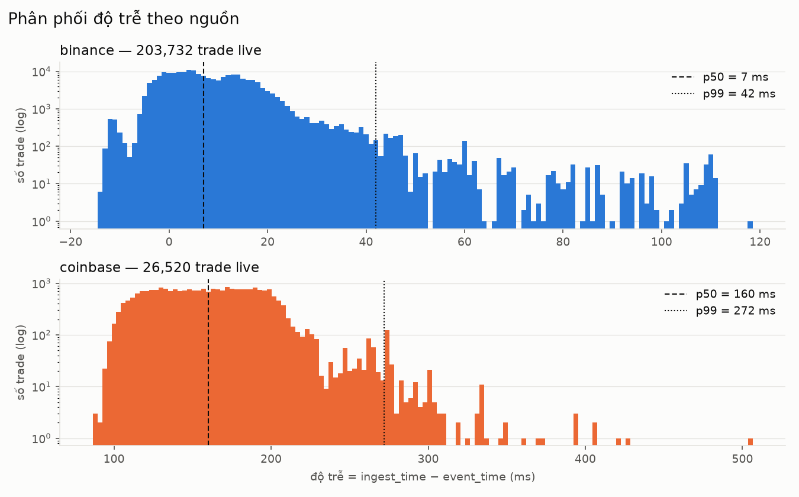
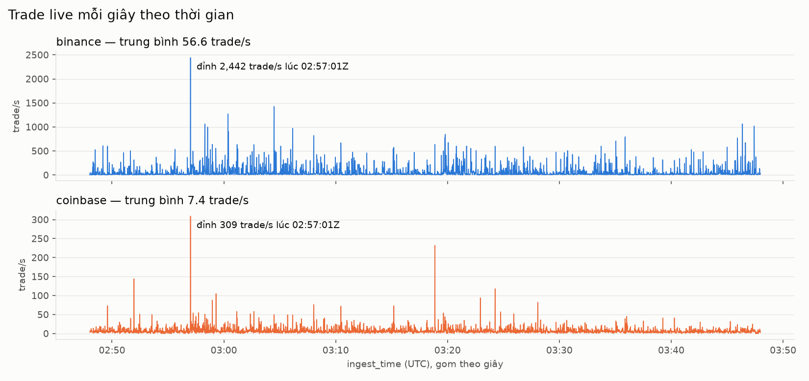

# Báo cáo Sprint 1: Data Engineer

**Người thực hiện:** Trung, Data Engineer
**Sprint:** S1 (thu dữ liệu thật, đo đặc tính nguồn, viết data contract)
**Ngày thu:** 2026-10-27, 02:48:00 → 03:47:59 UTC (09:48 → 10:48 giờ VN)

> Mọi số liệu trong báo cáo đều lấy từ dữ liệu thu thật. Bảng gốc:
> [`reports/throughput.md`](../../reports/throughput.md) và hai file CSV đi kèm. Kết quả đo đồng hồ:
> [`reports/clock_check.jsonl`](../../reports/clock_check.jsonl). Số liệu vnstock chỉ từ **một lần chạy thử
> 2 phút**, được đánh dấu riêng.

## 1. Mục tiêu

1. Thu 60 phút dữ liệu trade thật từ Binance và Coinbase, kèm điều kiện đồng hồ máy thu đã được kiểm chứng.
2. Viết recorder cho cổ phiếu VN30 (nguồn VCI, theo hướng vnstock).
3. Đo throughput, độ trễ, thứ tự, mất gói, và xuất thành bảng và biểu đồ.
4. Viết data contract (JSON Schema 2020-12) **dựa trên dữ liệu thật**, kèm validator tự động chạy trong CI.

## 2. Thiết lập

| | Binance | Coinbase | vnstock (VCI) |
|---|---|---|---|
| Giao thức | WebSocket, combined stream `<symbol>@trade` | WebSocket Advanced Trade, kênh `market_trades` | REST poll `POST …/market-watch/LEData/getAll` |
| Số mã | 10 (`…USDT`) | 10 (`…-USD`) | 10 mã VN30 |
| Cách giao trade | 1 message = 1 trade | Gom lô 250 ms, tối đa 100 trade/message | Mỗi lần poll trả 100 trade mới nhất của 1 mã |
| Recorder | `binance_ws.py` | `coinbase_ws.py` | `vnstock_poll.py` (mới) |

Có 6 coin thanh khoản cao xuất hiện ở cả hai sàn (BTC, ETH, SOL, XRP, ADA, DOGE) và 4 coin thanh khoản thấp ở mỗi sàn.
Định dạng lưu: NDJSON nén gzip, xoay file theo giờ. Payload gốc được giữ nguyên văn.

## 3. Quy trình và kiểm tra đồng hồ

Cột độ trễ bằng đồng hồ máy thu trừ đồng hồ sàn, nên **đồng hồ máy thu phải được kiểm tra trước**.
Công cụ `clock_check.py` đo offset theo kiểu NTP (SNTP tới 3 server, và API giờ của 2 sàn; mỗi tham chiếu
lấy mẫu có RTT nhỏ nhất). Ngưỡng: ±250 ms.

| Thời điểm (UTC) | Nhãn | Offset trung vị NTP | Kết quả |
|---|---|---:|---|
| 02:29:44 | precheck | **+1779,3 ms** | ✗ dừng, không thu |
| 02:47:06 | recheck (sau khi resync giờ Windows) | +16,9 ms | ✓ |
| 02:48:00 | before (ngay trước khi thu) | +15,9 ms | ✓ |
| 03:48:24 | after (ngay sau khi thu) | +42,0 ms | ✓ |
| 14:23:18 | drift-check | **+626,1 ms** | ✗ |

Offset dương nghĩa là máy thu chạy chậm hơn giờ chuẩn. Cả 5 tham chiếu độc lập (3 NTP, Binance, Coinbase)
luôn cho kết quả lệch nhau không quá vài ms, nên con số đo được là đáng tin. Nguồn gốc của lệch nằm ở
**đồng hồ Windows** (`w32tm` đo được cùng giá trị +1,778 s), còn WSL chỉ kế thừa giờ từ Windows.

## 4. Kết quả đo

Trước khi đo, mỗi bản ghi được xếp vào đúng một loại: **snapshot** (sàn đánh dấu), **trùng** (`event_id` đã gặp),
**phát lại** (event time trước lần kết nối đầu tiên), và **live** (phần còn lại). Throughput, độ trễ, thứ tự
và đứt seq chỉ tính trên live. Băng thông và số message tính trên mọi bản ghi.

### 4.1 Bảng A: theo nguồn

| | Binance | Coinbase |
|---|---:|---:|
| Tổng bản ghi | 203 732 | 28 127 |
| ├ live | 203 732 | 26 520 |
| ├ snapshot | 0 | 1 300 |
| ├ trùng | 0 | 219 |
| └ phát lại | 0 | 88 |
| Tổng message | 203 732 | 14 976 |
| `msg_seq` thiếu | — | 1 (là ack `subscriptions`, xem mục 5) |
| Message/s: trung bình / p95 / max | 56,59 / 255 / 2 442 | 4,16 / 8 / 20 |
| Trade live/s: trung bình / p95 / max | 56,59 / 255 / 2 442 | 7,37 / 20 / 309 |
| Trade/message: trung bình / max | 1 / 1 | 1,88 / 100 |
| Độ trễ live: p50 / p99 | 7 / 42 ms | 160 / 271,8 ms |
| Băng thông | 9,26 KB/s (32,6 MB/giờ) | 1,58 KB/s (5,5 MB/giờ) |
| Reconnect | 0 | 0 |

### 4.2 Bảng B: theo mã (chỉ live)

| Nguồn | Mã | Trade | Trade/s tb | p95 | max | Trễ p50 | p95 | p99 | max (ms) | Trễ âm | Sai thứ tự | Đứt seq |
|---|---|---:|---:|---:|---:|---:|---:|---:|---:|---:|---:|---:|
| binance | BTC-USDT | 84 431 | 23,45 | 136,05 | 1 463 | 8 | 27 | 45 | 111 | 8 536 | 0% | 0 |
| binance | ETH-USDT | 67 856 | 18,85 | 78 | 805 | 6 | 21 | 34 | 118 | 13 690 | 0% | 0 |
| binance | XRP-USDT | 22 708 | 6,31 | 36 | 174 | 5 | 21 | 38,9 | 110 | 4 789 | 0% | 0 |
| binance | SOL-USDT | 16 225 | 4,51 | 22 | 256 | 6 | 21 | 44 | 109 | 2 939 | 0% | 0 |
| binance | DOGE-USDT | 8 298 | 2,31 | 12 | 107 | 6 | 21 | 47 | 109 | 1 600 | 0% | 0 |
| binance | ADA-USDT | 2 298 | 0,64 | 5 | 87 | 6 | 21 | 59 | 81 | 396 | 0% | 0 |
| binance | ALGO-USDT | 1 119 | 0,31 | 1 | 177 | 7 | 21 | 46 | 110 | 321 | 0% | 0 |
| binance | CELR-USDT | 437 | 0,12 | 1 | 14 | 3 | 18 | 23 | 24 | 142 | 0% | 0 |
| binance | ONE-USDT | 212 | 0,06 | 0 | 22 | 9 | 18 | 30 | 45 | 27 | 0% | 0 |
| binance | ZIL-USDT | 148 | 0,04 | 0 | 19 | 6 | 16 | 42,4 | 67 | 21 | 0% | 0 |
| coinbase | BTC-USD | 16 511 | 4,59 | 13 | 191 | 160 | 215 | 273 | 504 | 0 | 0% | 0 |
| coinbase | ETH-USD | 4 784 | 1,33 | 5 | 97 | 160 | 215 | 281,2 | 349 | 0 | 0% | 0 |
| coinbase | SOL-USD | 1 983 | 0,55 | 2 | 25 | 159 | 205 | 226,7 | 428 | 0 | 0% | 0 |
| coinbase | XRP-USD | 1 824 | 0,51 | 2 | 88 | 164 | 212 | 247,8 | 421 | 0 | 0% | 0 |
| coinbase | ADA-USD | 851 | 0,24 | 1 | 26 | 150 | 201 | 245,5 | 319 | 0 | 0% | 0 |
| coinbase | DOGE-USD | 427 | 0,12 | 1 | 52 | 164 | 201 | 230,2 | 286 | 0 | 0% | 0 |
| coinbase | ALGO-USD | 89 | 0,02 | 0 | 5 | 152 | 204,2 | 219,2 | 250 | 0 | 0% | 0 |
| coinbase | SKL-USD | 42 | 0,01 | 0 | 3 | 166,5 | 224,1 | 264,3 | 286 | 0 | 0% | 0 |
| coinbase | BAND-USD | 5 | 0 | 0 | 1 | 136 | 187,8 | 194,4 | 196 | 0 | 0% | 0 |
| coinbase | CTSI-USD | 4 | 0 | 0 | 4 | 161,5 | 209 | 209 | 209 | 0 | 0% | 0 |

Cột "Sai thứ tự" tính ở mức message (event time nhỏ hơn mốc lớn nhất của các message đến trước). Cột "Đứt seq"
tính trên tập trade id đã sắp xếp. Cột "thiếu id" trong file gốc bằng 0 ở mọi dòng.

### 4.3 Biểu đồ

### 4.4 vnstock (chạy thử 2 phút lúc 02:52 UTC, sơ bộ)

| Chỉ số | Giá trị |
|---|---|
| Bản ghi | 1 274 (1 000 snapshot của lần poll đầu, 274 live) |
| Trùng `(symbol, id)` | 0 |
| Số request | 238 trong 2 phút (≈ 119/phút, giới hạn 180) |
| Số trade mới nhiều nhất trong một lần poll | 20 (giới hạn 100), không có `possible_gap` |
| Độ trễ live p50 / p95 / max | 3 908 / 6 196 / 7 521 ms |

## 5. Các phát hiện

Các phát hiện được trình bày như kết quả nghiên cứu, kèm bằng chứng và cách đã kiểm chứng.

**P1. Đồng hồ máy thu lệch và còn trôi.** Lúc đầu lệch +1779 ms. Sau khi resync, đồng hồ vẫn trôi +26 ms
trong giờ thu, rồi tới +626 ms sau 10,6 giờ (≈ 55 ms/giờ).
*Bằng chứng trực tiếp trong dữ liệu:* p50 độ trễ theo khung 10 phút giảm cùng một mức ở **cả hai sàn**
(Binance 22 → −2 ms, Coinbase 176 → 147 ms). Hai sàn đi qua hai đường mạng khác nhau mà dịch chuyển như nhau,
nên nguyên nhân là đồng hồ máy thu. Hệ quả: **32 461 trade Binance (15,9%) có độ trễ âm**, bắt đầu xuất hiện
từ khoảng 03:10 UTC. Số liệu được **giữ nguyên, không hiệu chỉnh**. Độ trễ Binance tuyệt đối vì vậy có sai số
cỡ vài chục ms.

**P2. Coinbase gửi lại lịch sử giữa phiên mà không có reconnect.** Lúc 03:20:31 (ALGO-USD), 03:21:21 (BAND-USD)
và 03:33:00 (CTSI-USD), sàn gửi một message `snapshot` gồm 100 trade, ngay sau đó là một message **`update`**
cũng gồm 100 trade cũ, có trade từ tận 19,7 giờ trước. Message `update` này **không có cờ snapshot**, nên recorder
không thể nhận ra. Lúc đó ops log không ghi nhận lần ngắt kết nối nào. Đây là lý do có 88 bản ghi "phát lại"
và phần lớn trong 219 bản ghi "trùng".

**P3. Snapshot khi subscribe gồm 100 trade cho mỗi mã** (tổng 1000 trade), không phải khoảng 100 cho cả lô
như mô tả ban đầu. Với coin ít giao dịch, snapshot quét ngược rất xa: snapshot của BAND-USD chứa trade từ
khoảng 65 giờ trước. Nếu không tách loại snapshot, độ trễ p50 của BAND-USD sẽ bị tính thành khoảng 19 giờ.

**P4. Coinbase giới hạn 100 trade mỗi message, và gửi trùng khi dồn tải.** Lúc 02:57:01, message 2081 chứa đủ
100 trade BTC-USD, và message 2082 ngay sau đó lặp lại 7 trade trong số đó. Không mất trade nào (BTC-USD liên
tục 16 611 id). Hệ quả là luồng live cũng cần khử trùng theo `event_id`.

**P5. Không mất gói, không sai thứ tự.** Binance: 0 đứt id, 0 lùi, 0 trùng trên 203 732 trade (đọc theo thứ tự
nhận). Cả 10 mã gộp lại vẫn đến đúng thứ tự event time tuyệt đối. Coinbase: 0 đứt id trên tập live ở cả 10 mã.
Có 1 `sequence_num` bị thiếu (số 10), nhưng đã kiểm chứng đó là message ack `subscriptions` mà recorder lọc bỏ:
một kết nối thử cho thấy ack này chiếm một số thứ tự. Trong mỗi message, Coinbase xếp trade theo id **giảm dần**.

**P6. Đỉnh tải đồng thời ở hai sàn.** Lúc 02:57:01 UTC, Binance đạt 2 442 trade/s (gấp 43 lần trung bình) và
Coinbase đạt 309 trade/s, ở cùng một giây. Event time của 2 442 trade Binance đều nằm trong giây đó
(02:57:01.001 → .975), nên đây là đợt tải thật của thị trường, không phải dữ liệu bị dồn lại do trễ.

**P7. Chênh lệch thanh khoản giữa hai sàn.** Với cùng một coin, Binance có nhiều trade hơn hẳn:
BTC 84 431 so với 16 511 (5,1 lần), ALGO 1 119 so với 89 (12,6 lần). Các coin thanh khoản thấp trên Coinbase
gần như không có trade (BAND-USD 5, CTSI-USD 4 trade trong một giờ). Mô tả ban đầu "Binance khoảng 35–60
trade/s, Coinbase khoảng 3–4 trade/s" khớp nếu hiểu con số của Coinbase là **message/s** (4,16), còn **trade/s**
thực tế là 7,37.

**P8. Ba nguồn có độ trễ chênh nhau ba bậc độ lớn.** Binance khoảng 10 ms, Coinbase khoảng 160 ms (nguyên nhân
là lô 250 ms, phân phối gần như phẳng từ khoảng 100 đến 210 ms), vnstock khoảng 4 s (nguyên nhân là chu kỳ poll
5 s, và `truncTime` chỉ chính xác tới giây). Hệ quả cho thiết kế watermark được phân tích trong
[`docs/papers/dataflow-model.md`](../papers/dataflow-model.md).

**P9. Lỗi đo trong `analyze.py` ban đầu.** Bản đầu tiên báo 49 682 "đứt seq" và 13,55% "sai thứ tự" cho Binance BTC.
Nguyên nhân là `sort_values` không ổn định, trong khi có 67 860 cặp trade BTC liên tiếp trùng cùng một mili giây
`ingest_time`. Ngoài ra snapshot bị tính như trade live, và trade/s của mã ít giao dịch bị chia theo khoảng thời gian
hoạt động của chính mã đó thay vì cả phiên. Các lỗi đã được sửa (mục 6). Số liệu ở mục 4 là bản sau khi sửa.

## 6. Thay đổi so với trạng thái đầu sprint

| File | Thay đổi | Lý do |
|---|---|---|
| `ingest/clock_check.py` | **Mới.** File này được nhắc đến nhưng không có trong repo. | Bắt buộc phải có trước khi thu |
| `ingest/coinbase_ws.py` | Thêm `transport.is_snapshot` (theo `events[].type`) | Trước đây chưa có, dù được mô tả là đã có |
| `ingest/vnstock_poll.py` | **Mới.** Gọi thẳng endpoint VCI | Gói `vnstock` và `vnai` đã bị gỡ khỏi PyPI; `intraday()` biến đổi dữ liệu (giá chuyển sang float rồi chia 1000) |
| `ingest/record.py` | Thêm nguồn `vnstock` | `--sources vnstock` |
| `ingest/analyze.py` | Sửa các lỗi ở P9; phân loại bản ghi; thêm 2 biểu đồ | Số liệu ban đầu sai |
| `ingest/Analyze.py` | Xoá | Bản sao y hệt `analyze.py`; trên Windows/macOS hai tên này đụng nhau |
| `contracts/*` | **Mới:** 3 schema, README, `validate.py` | Mục tiêu 4 |
| `tests/fixtures/*` | **Mới:** 62 bản ghi hợp lệ, 22 ca lỗi cố ý, script sinh fixture | Dùng cho CI |
| `Makefile`, `ci.yml`, `requirements-ingest.txt` | Các target `record`, `analyze`, `validate-contracts`; bước CI tương ứng; thêm `tabulate`, `matplotlib`, `jsonschema` | |

## 7. Data contract

Ba schema ở [`platform/contracts/`](../../platform/contracts/), lý do của từng quyết định nằm trong README của thư mục.
- **Toàn bộ 231 859/231 859 bản ghi đã thu đều hợp lệ.**
- Cả 22/22 ca lỗi cố ý đều bị bắt đúng lý do: giá dạng number, giờ thiếu `Z`, giờ có offset, giờ có micro giây,
  mã sai dạng, thiếu trường, thêm trường lạ, major 2, nguồn lạ, và các lỗi chéo trường.

## 8. Hạn chế

- **Chỉ có một giờ dữ liệu, vào một buổi sáng giờ VN** (tức đêm ở Mỹ). Throughput sẽ khác vào giờ giao dịch ở Mỹ.
- Độ trễ tuyệt đối mang sai số đồng hồ cỡ +16 đến +42 ms (P1). So sánh tương đối giữa các nguồn vẫn có giá trị.
- vnstock mới chạy thử 2 phút và chưa có schema riêng cho payload. Recorder không biết lịch nghỉ lễ của HOSE.
- CI trên GitHub chưa được chạy thật: các thay đổi chưa được commit hay push. Phần lint và validate đã chạy đạt
  trên máy local (Python 3.14; CI dùng 3.11).
- Không có Docker trong WSL, nên `make check` (compose) không chạy được trên máy này. Vấn đề này có từ trước sprint.

## 9. Việc tiếp theo

1. Sửa đồng hồ một cách bền vững: tăng tần suất đồng bộ giờ của Windows, chạy `clock_check` định kỳ trong lúc thu,
   và ghi offset vào ops log để hiệu chỉnh độ trễ khi phân tích.
2. Thu vnstock trọn một phiên HOSE, sau đó viết `vnstock_trade.schema.json`.
3. Đẩy dữ liệu vào Kafka. Khử trùng theo `event_id` ở tầng đầu. Mỗi nguồn có watermark riêng
   (Binance 0–200 ms, Coinbase 500 ms, vnstock khoảng 10 s).
4. Biến các phát hiện P1–P4 thành detector observability: độ trễ âm, bản ghi phát lại không có cờ, tỷ lệ trùng,
   và lô chạm giới hạn 100 trade.
