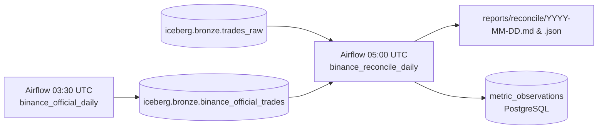

# Đối soát D+1 và Phát hiện khoảng hở Trade ID (Sprint 4 — DE)

Tài liệu này mô tả hai thành phần Data Engineering bổ sung trong Sprint 4:

1. **DE-A — Gap Detection** (`observability/reconcile/gap_detection.py`, `run_gap_detection.py`): phát hiện mất gói, trùng lặp, đảo thứ tự trên chuỗi `trade_id` của stream theo từng `(source, symbol)`.
2. **DE-B — D+1 Reconciliation** (`observability/reconcile/reconcile.py`, DAG `binance_reconcile_daily`): đối soát dữ liệu stream `iceberg.bronze.trades_raw` với file chính thức `iceberg.bronze.binance_official_trades`.

> **Lưu ý kiến trúc (Binance vs Coinbase):**
> - **Gap detection (DE-A)** áp dụng cho **cả Binance và Coinbase** vì cả hai sàn đều dùng `trade_id` nguyên tăng liên tục theo từng mã (`binance`: `payload.t`, `coinbase`: `int(payload.trade_id)`). Lưu ý Coinbase có thể gửi các trade trong cùng 1 batch WebSocket theo thứ tự ngược nên cần xét thứ tự nhận (`ingest_ts` / `bronze_ts`).
> - **Đối soát D+1 (DE-B)** chỉ áp dụng cho **Binance** (nguồn duy nhất có file Public Data D+1 kèm checksum SHA-256). Coinbase không dùng đối soát lô D+1 mà chuyển sang **đối soát thời gian thực (real-time reconciliation)** và kiểm soát chất lượng ngay tại nguồn bằng Data Contract.

---

## 1. Luồng đối soát D+1 (Binance)



1. **Nạp file chính thức**: DAG `binance_reconcile_daily` (05:00 UTC) kiểm tra và gọi `binance_official.load_day()` cho ngày `D-1` (kiểm tra SHA-256, idempotent theo `(file_date, symbol)`). Nếu Binance chưa công bố file, task retry tối đa 3 lần × 60 phút, hoặc đánh dấu `OFFICIAL_NOT_AVAILABLE`.
2. **So khớp theo `trade_id`**:
   - `missing_in_stream`: ID có trong file chính thức nhưng không có trong stream.
   - `extra_in_stream`: ID có trong stream nhưng không có trong file chính thức.
   - `value_mismatch`: ID có ở cả hai bên nhưng sai `price`, `qty` hoặc `time_ms` vượt quá dung sai trong [`config/reconcile.yaml`](../../config/reconcile.yaml).
3. **Độ phủ phát hiện (`detection_coverage`)**: Giao giữa `missing_in_stream` và các khoảng hở do `gap_detection` phát hiện trên stream → đo xem bao nhiêu % trade bị mất đã được phát hiện ngay từ chuỗi ID stream.
4. **Xuất báo cáo**: Ghi file Markdown và JSON vào `reports/reconcile/YYYY-MM-DD.{md,json}`. Với ngày thu dở dang (ví dụ 26/11), hỗ trợ `--from HH:MM --to HH:MM` và ghi rõ trạng thái ngày chưa đầy đủ.

---

## 2. Ý nghĩa từng trạng thái (`status`)

| Trạng thái | Ý nghĩa |
|---|---|
| `OK` | 100% trade ID khớp, không thiếu, không thừa, không sai lệch giá/khối lượng/thời gian trong dung sai. |
| `MISSING_IN_STREAM` | Có ít nhất 1 `trade_id` trong file chính thức không xuất hiện trong `bronze.trades_raw`. |
| `EXTRA_IN_STREAM` | Có `trade_id` trong stream nhưng không nằm trong file chính thức (thường do lệch ranh giới UTC hoặc dữ liệu bất thường). |
| `VALUE_MISMATCH` | Số lượng ID khớp nhưng có bản ghi sai lệch `price`, `qty`, hoặc `time_ms` vượt dung sai. |
| `OFFICIAL_NOT_AVAILABLE` | Chưa có dữ liệu file chính thức của ngày đó trong `bronze.binance_official_trades`. |

---

## 3. Metric và nhãn

Các metric được ghi vào bảng `metric_observations` trong PostgreSQL (`finobs_metrics`) và định nghĩa trong [`observability/metric_catalog.yaml`](../../observability/metric_catalog.yaml):

### DE-A (Gap detection)
Nhãn (`dimensions`): `source`, `symbol`
- `trade_id_gap_count` — số khoảng hở riêng biệt
- `trade_id_gap_missing_total` — tổng số `trade_id` bị thiếu
- `trade_id_duplicate_count` — số `trade_id` bị trùng lặp
- `trade_id_out_of_order_count` — số lần đảo thứ tự nhận

### DE-B (Reconciliation)
Nhãn (`dimensions`): `source` (`binance`), `symbol`, `date` (`YYYY-MM-DD`)
- `reconciliation_match_ratio` — tỷ lệ khớp (`matched / official_count`)
- `reconciliation_missing_trades` — số trade thiếu trong stream
- `reconciliation_extra_trades` — số trade thừa trong stream
- `reconciliation_value_mismatch` — số trường sai lệch giá/khối lượng/thời gian

---

## 4. Cách chạy và kiểm thử cục bộ

```bash
# Chạy đối soát trên dữ liệu giả (fixtures)
make reconcile DATE=2026-11-27 SYMBOLS=BTCUSDT,ETHUSDT FIXTURE_DIR=tests/fixtures/reconcile

# Chạy trên ngày thu dở dang có giới hạn cửa sổ
make reconcile DATE=2026-11-26 FROM=08:00 TO=23:59 FIXTURE_DIR=tests/fixtures/reconcile

# Chạy gap detection trên file raw
python observability/reconcile/run_gap_detection.py --in tests/fixtures/raw --dry-run

# Chạy toàn bộ unit test và validate contract
make test
make validate-contracts
```
